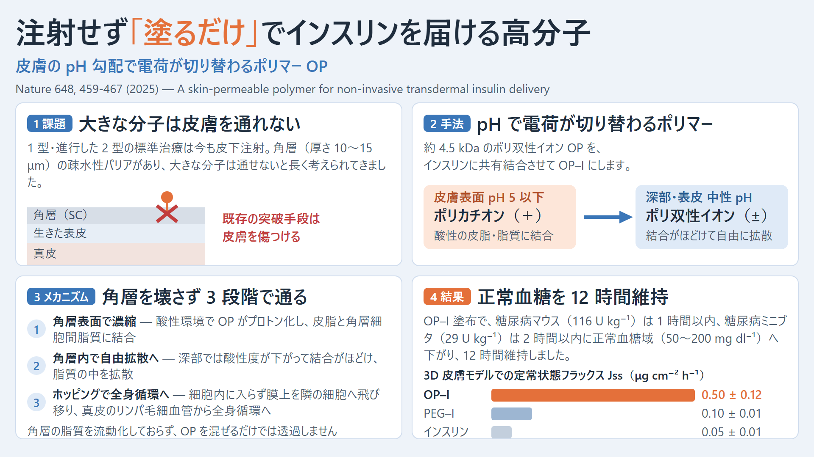

# 注射せず「塗るだけ」でインスリンを届ける高分子 — 皮膚の pH 勾配で電荷が切り替わるポリマー OP

## この論文のひとことまとめ

皮膚の表面は酸性（pH 約 5）で、その下は中性です。この pH の違いに応じて電荷が切り替わる水溶性のポリマー OP を使うと、皮膚の最外層（角層）から真皮までを通り抜けて血流に到達することが示されました。この OP を結合させたインスリン（OP–I）を皮膚に塗るだけで、1 型糖尿病モデルマウス（116 U kg−1）と糖尿病ミニブタ（29 U kg−1）の血糖値が正常域まで下がりました。ここで U はインスリンの量を表す国際単位（unit）で、U kg−1 は体重 1 kg あたりの単位数を意味します。また OP–I は分子の一部が OP なので、用量は「含まれているインスリン分に換算した量（インスリン等価用量）」で表されます。皮膚を傷つける器具も、角層を壊す添加剤も使いません。なお、ヒトでの臨床試験は本論文には含まれていません。

## なぜこの研究が重要か

1 型糖尿病と進行した 2 型糖尿病の標準治療は、現在も皮下注射です。注射には痛み、針への恐怖、皮膚の合併症、そして治療継続の難しさ（コンプライアンス低下）がついてきます。非侵襲的なインスリン投与は長く探索されてきましたが、論文は「まだ成功していない（has not yet been successful）」と述べています。

もし「塗るだけ」でインスリンが血流に届くなら、この負担はかなり軽くなります。この論文は、その実現に向けた材料側の答えを一つ提示しています。しかも著者らは、OP を結合させる手法はペプチド・タンパク質・核酸といった生体高分子一般の経皮送達に応用できる可能性があると述べており（ただし本論文で実証されているのはインスリンのみです）、インスリンに限らない広がりを持ちます。

## 背景：何が問題だったのか

経皮投与（塗る投与）は、適度な疎水性をもつ 500 Da 未満の低分子薬には広く使われています。一方で、タンパク質・ペプチド・ポリマーのような大きな分子では、皮膚バリアのせいで不可能だと長く考えられてきました。

皮膚バリアの構造は手強いものです。最外層の角層（SC, stratum corneum）は厚さ 10〜15 μm で、脱水して死んだ角層細胞（corneocyte）が高度に配向した脂質の層に埋め込まれた、疎水性のマトリックスになっています。その下の生きた表皮や真皮には、タイトジャンクション（tight junction、隣り合う細胞の隙間を塞ぐ接着構造）もあり、細胞同士が密に封じられています。

これを突破する既存の手段には、いずれも代償がありました。

- 角層の脂質二重層を流動化する化学的促進剤
- 電気デバイス、超音波、ジェット注射（皮膚表面に一時的な通り道を作る）
- 角層を貫いて真皮に達するマイクロニードル

これらはどれも皮膚の完全性を損ない、不便さ・感染・安全性の懸念を生じます。

もう一つの方向として、正電荷を持つカチオン性ペプチドが知られていました。皮脂や角層の中にある負電荷のアルキルカルボン酸と静電的に結合でき、経皮性が報告されています。ところが結合が強すぎて角層内に固定されてしまい、そこから拡散できません。結果として実際の通り道は毛穴や汗腺を通る「付属器経路（appendageal paths）」になりますが、ヒト皮膚で付属器が占める面積は 0.1% 未満しかなく、効率が上がりません。

そこで著者らは、こう考えました。角層の表面では結合する「ポリカチオン」として振る舞い、より深い角層では電荷が中性的な「ポリ双性イオン」へ転換して自由に拡散できるポリマーなら、皮膚を通り抜けられるはずだ、と。狙ったのは、皮脂層・角層表面の酸性（pH 約 5）から深部角層・生きた表皮の中性へという、皮膚そのものが持つ pH 勾配です。

## 提案手法：何をしたのか

### 中核アイデア — pH で電荷が切り替わるポリマー OP

主役は OP、正式名は poly[2-(N-oxide-N,N-dimethylamino)ethyl methacrylate] です。高い水溶性を持つポリ双性イオン（polyzwitterion）で、同一分子内に正電荷と負電荷を併せ持ち全体としては中性になるポリマーです。

OP の性質は pH で切り替わります。鍵になるのがプロトン化（protonation）です。これは分子に水素イオン（プロトン）が付くことで、付いた分だけ分子が正電荷を帯びます。逆にプロトンが外れることを脱プロトン化といいます。周囲が酸性であるほど水素イオンが豊富なので、プロトン化は起こりやすくなります。

この性質により、OP は pH 5 以下ではプロトン化して正電荷を帯びたポリカチオンになり、中性 pH では脱プロトン化してポリ双性イオンになります（論文では「pH > 7 で双性イオン、pH が下がるにつれ徐々にプロトン化して正電荷」とも表現されています）。つまり酸性の皮膚表面では正電荷を帯び、中性の深部では電荷が打ち消し合った中性になる、ということです。この切り替わりが皮膚の pH 勾配と一致することで、皮膚表面に結合する段階と、角層細胞間の脂質マトリックスを拡散する段階を、一つの分子で両立させられます。

### 透過メカニズム — 3 段階

著者らが示す経路は次の 3 段階です。

1. **角層表面での濃縮**: 塗布すると皮膚表面の酸性環境が OP をプロトン化し、脂肪酸を含む酸性の皮脂と角層細胞間脂質に静電的に濃縮されます。角層細胞間脂質は約 15% の脂肪酸を含みます。
2. **角層内で自由拡散へ切り替わり**: 上部角層より深い場所では酸性度が下がるため、静電結合がほどけます。OP および OP–I は角層細胞間脂質の中を拡散して、生きた表皮へ進みます。
3. **表皮・真皮を「ホッピング」で移動し、リンパ経由で全身循環へ**: 生きた表皮と真皮では細胞内に取り込まれず、細胞膜の上を隣の細胞へ飛び移るように（hopping）移動します。これにより細胞内での分解を回避します。真皮では漏れやすいリンパ毛細血管に排出され、そこから全身循環に入ります。

### 「壊して通す」のではないことの確認

既存の化学的促進剤との違いを示すため、著者らは否定的なコントロールも置いています。

- 赤外分光（FTIR, Fourier-transform infrared spectroscopy。分子の振動を赤外線で捉え、脂質の並びの乱れ具合を調べる手法）の結果、OP も OP–I も角層内の脂質の流動性を高めていませんでした。つまり角層を壊したり流動化したりして通っているのではありません。
- OP を蛍光色素や蛍光標識インスリンと単純に「混ぜる」だけでは経皮透過は向上せず、混合物の塗布では血糖降下効果も出ませんでした。効率的な皮膚透過が得られたのは、OP を共有結合でつないだ場合（OPCy5、OP–ICy5、OP–I）だけです。

### 材料の作り方

作り方の骨格はシンプルです。まず、分子の長さ（分子量）をそろえて作れる重合法で、約 4.5 kDa の OP を用意します。次に、インスリン側と OP 側にそれぞれ噛み合う化学的な「留め具」を付け、金属触媒を使わずに進む反応でその留め具同士を結合させて OP–I にします。

原文の語で書くと次のとおりです。OP の分子量はリビングラジカル重合（開始した重合が途中で止まらない方式で、分子量をそろえやすい）によって約 4.5 kDa に制御されています。インスリン側の留め具は、組換えヒトインスリンのリジン残基（アミノ酸の一種で、反応しやすいアミン基を側鎖に持つ）に導入したアジド基です。OP 側の留め具は末端の DBCO 基です。この 2 つを SPAAC（strain-promoted alkyne-azide cycloaddition、歪み促進アルキン–アジド環化付加）という銅触媒不要のクリック反応でつなぎます。

対照として、PEG（5 kDa）を同様に結合させた PEG 化インスリン PEG–I も合成されました。角層内の分布を電子顕微鏡で直接見るために、5 nm の金ナノ粒子を OP に結合させた OP–AuNPs も用意されています。

## 結果：何が分かったのか

まず投与の仕方を押さえておきます。マウスでは、除毛クリームで背部の皮膚を露出させ、そこに 1.13 cm2 の小さな容器（拡散セル）を装着して、塗布液を皮膚に接触させ続けます。ミニブタでは腹部皮膚にクリームを塗り、プラスチックフィルムで覆います。

### OP 単体が皮膚を通り抜ける

蛍光標識した OPCy5 をマウスの背部皮膚に塗って 4 時間後、共焦点顕微鏡（CLSM, confocal laser scanning microscopy。試料の特定の深さだけに焦点を合わせて撮れるため、皮膚を層ごとに見られます）で皮膚の全層に蛍光が観察されました。対照の PEGCy5 は皮膚表面にとどまったままです。OP–AuNPs を使った電子顕微鏡の元素マッピングでは、OP–AuNPs が角層細胞間の脂質ラメラ（lipid lamellae、層状に重なった脂質の構造）の中に分布していることが確認されました。

血流への到達は速く、塗布した OPCy5 は 0.5 時間以内に血流へ達し、約 2 時間後に血中最高濃度になりました。循環後は主に肝臓に集積し、次いで腎臓・肺でした。ミニブタの腹部皮膚に塗った場合も、OPCy5 は皮膚全層に分布しました。

### OP をつないでもインスリンの機能は損なわれない

薬として使うには、ポリマーを結合してもインスリンが働く必要があります。

- インスリン受容体への結合の強さは、表面プラズモン共鳴（SPR, surface plasmon resonance。分子が表面に結合する様子をリアルタイムに追う測定法）で調べられました。指標は解離定数 Kd で、これは「どれくらい薄い濃度でも結合していられるか」を表すため、値が小さいほど結合が強いことを意味します。OP–I が 26.06 nM、インスリンが 14.03 nM で、OP–I のほうがやや弱い側ですが同じ桁に収まっており、論文は「実質的な差はなかった（No substantial difference）」と記述しています。結合・解離の速度定数も同等でした。
- 全原子分子動力学（MD, molecular dynamics。原子の動きを時間を追って計算するシミュレーション）でも受容体結合親和性が見積もられました。インスリン受容体にはインスリンが結合する部位が 2 か所あり、それぞれ site 1 / site 2 と呼ばれます。結合親和性はエネルギーとして表され、負の側に大きいほど強く結合することを意味します。OP–I は site 1 で −14.0 kcal mol−1、site 2 で −22.9 kcal mol−1。インスリンはそれぞれ −16.7、−22.0 kcal mol−1 でした。どちらの部位でも両者は近い値です。
- 円二色性（circular dichroism。タンパク質の立体構造を光の吸収の違いから調べる測定法）では、インスリンの二次構造（α ヘリックスなど、タンパク質の局所的な折りたたみ方）に変化がありませんでした。つまり OP をつないでもインスリンの形は変わっていません。血糖降下効果も変化しませんでした。
- 静脈内投与での血中半減期は、OP–I が約 15〜20 分、天然インスリンが約 5〜10 分でした。

### 皮膚透過の定量

再構成ヒト表皮を模した 3D 皮膚モデル EpiKutis での測定値が、透過性の差を数字で示しています。

| 試料 | 定常状態フラックス Jss（μg cm−2 h−1） |
| --- | --- |
| OP–I | 0.50 ± 0.12 |
| PEG–I | 0.10 ± 0.01 |
| インスリン | 0.05 ± 0.01 |

透過係数 Kp では、OP–I は PEG–I の 4.50 倍、インスリンの 9.17 倍でした。蛍光観察では、OP–IFITC が 30 分以内に表皮層全体へ広がる一方、PEG–IFITC と標識インスリンは表面に限局した弱い蛍光しか示しませんでした。

### 生体内での分布

二光子顕微鏡（組織の深い場所まで傷めずに撮れる蛍光顕微鏡）で深さを変えて連続撮影する z-stack 観察により、OP–IFITC は皮膚組織の深部、さらに皮下組織（subcutis）にまで到達していました。PEG–IFITC と遊離インスリンは皮膚内にまばらな蛍光しか示しません。OP–ICy5 では塗布 10 分後の時点で、標識した皮下脂肪組織に既に相当量の蛍光が認められ、時間とともに蓄積しました。

ラットでは、皮下のリンパ毛細血管（リンパ管の細胞に多い LYVE-1 というタンパク質を目印に染め分けたもの）の周囲と内部に多量の OP–ICy5 が見られました。これは、皮下投与された大分子がリンパ取り込みを経て全身循環に入るという既報と整合します。ミニブタ皮膚でも 4 時間の塗布で有効な透過が確認されました。なお、拡散セルを外した後は、OP–ICy5 は 8 時間以内に皮膚からクリアされています。

### 血漿インスリン濃度（糖尿病マウス）

OP–I を塗布すると血漿インスリン濃度は急速に上昇し、1 時間後に約 230 μU ml−1（血液 1 ml あたりのインスリン量を国際単位の 100 万分の 1 を単位として表した値）でピークに達し、その後 12 時間後に約 30 μU ml−1 まで徐々に低下しました（インスリン等価用量 116 U kg−1、n = 5 mice）。

興味深いのは皮下注射との比較です。最初の 2 時間は皮下注射インスリンとほぼ同等のプロファイルですが、それ以降は一貫して 1.6〜6 倍高い血漿レベルが維持されました。塗布した遊離インスリンや PEG–I は血中インスリン値に影響しませんでした。3 日連続の反復塗布でも、血漿インスリンのプロファイルはきわめて類似していました。

### 血糖降下効果（STZ 誘導 1 型糖尿病マウス）

本論文が正常血糖域とするのは 50〜200 mg dl−1 です。

- 皮下注射インスリン（5 U kg−1）は 1 時間以内に血糖値（BGL）を約 400 → 約 100 mg dl−1 に下げましたが、4 時間以内に約 400 mg dl−1 の高血糖へリバウンドしました。
- 塗布した遊離インスリンと PEG–I は、BGL にほぼ無効（negligible effect）でした。
- OP–I の塗布（116 U kg−1）は 1 時間以内に BGL を 200 mg dl−1 未満へ下げ（皮下注射と同等の速さ）、しかも正常血糖域を 12 時間維持しました（n = 8 mice）。

低用量（58 または 29 U kg−1）では BGL の低下は緩やかになりましたが、それでも正常域まで回復しました。著者らはここから、個々の患者向けの用量最適化の可能性を指摘しています。健常マウスでも血糖降下効果が確認され、塗布部位（背部か腹部か）は経皮送達効率と血糖降下活性に影響しませんでした。

腹腔内糖負荷試験（IPGTT）では、OP–I を 1 時間塗布した後にグルコース（1.5 g per kg）を投与すると、BGL は 30 分以内に 330 mg dl−1 でピークを打ち、1 時間以内に約 100 mg dl−1 まで低下して、その後は正常血糖を維持しました。参照の健常マウスは似たプロファイルながら、2 時間後でも BGL が 200 mg dl−1 を超えていました。インスリンまたは PEG–I を塗布した糖尿病マウスは、糖負荷後に BGL が約 600 mg dl−1 まで上昇し、高血糖のままでした。

### 糖尿病ミニブタ

ヒト皮膚に構造が近いミニブタでも試験されています。OP–I、PEG–I または天然インスリンを油中水型（water-in-oil、油の中に水の粒が分散したタイプ）のクリームに分散し、腹部皮膚に塗布しました（インスリン等価用量 29 U kg−1、400 cm2、n = 3 minipigs）。

OP–I クリームは 2 時間以内に BGL を正常血糖域まで下げ、6 時間で最低値 100 mg dl−1 に達し、12 時間にわたって正常血糖を維持しました。低用量群（7.25 U kg−1、100 cm2）でも同様の降下傾向が見られましたが、BGL 調節の効率は低下しました。塗布した PEG–I や遊離インスリンでは、ミニブタの BGL にほぼ明らかな変化はありませんでした。

### メカニズムの検証

**角層での挙動**。塗布 4 時間後にテープで剥がした角層を脂質染色すると、OP–I の蛍光と脂質染色が顕著に重なり、OP–I が角層細胞を囲む脂質の中に局在していることが分かりました。MD シミュレーション（モデル角層脂質はセラミド・コレステロール・脂肪酸の等モル混合物）では、pH 5.5 での角層脂質への結合自由エネルギーが OP = −8.5、OP–I = −11.7、インスリン = −6.0 kcal mol−1 でした。結合自由エネルギーは負に大きいほど強く結合することを意味するので、酸性 pH では OP 側（−8.5、−11.7）がインスリン（−6.0）より脂質に強く結合する、と読めます。

一方で、脂質表面方向の拡散エネルギー障壁は OP = 0.9 ± 0.1、OP–I = 1.7 ± 0.2、インスリン = 2.2 ± 0.3 kcal mol−1 でした。拡散エネルギー障壁は、分子が動き出すのに越えなければならないエネルギーの山で、低いほど動きやすいことを示します。ここでは OP 側のほうが低く、より動きやすい側です。Stokes–Einstein 関係から導いた摩擦係数も OP = 2.07 × 10−10、OP–I = 4.31 × 10−10、インスリン = 8.49 × 10−10 Ns m−1 でした。摩擦係数は分子の動きにくさを表す量で、小さいほど速く拡散します。OP 側が小さいことは、脂質による「局所トラップ」が少なく拡散が速いことを意味します。pH 7.0 では OP が双性イオン状態に転換し、脂質との静電相互作用が大幅に減って自由に拡散できるようになります。

**生きた表皮・真皮での膜ホッピング**。ヒトケラチノサイト（keratinocyte、皮膚表皮の大半を占める主要な細胞）の細胞株 HaCat を球状に固めて培養したもの（スフェロイド）では、OP–IFITC の 12 時間処理で強い蛍光が得られ、PEG–IFITC と標識インスリンは弱い蛍光のみでした。

ここで肝になるのが、取り込み経路を止める実験です。細胞が物質を膜で包み込んで内部に取り込む仕組みをエンドサイトーシス（endocytosis）、その逆に内部の物質を膜ごと外へ出す仕組みをエキソサイトーシス（exocytosis）といいます。これらを止める阻害剤を複数前処理しても、OP–IFITC の浸潤は抑制されませんでした。取り込み経路を塞いでも透過が変わらないということは、OP–I は細胞内に取り込まれて運ばれているのではない、ということになります。実際、24 時間インキュベートしても OP–ICy5 は細胞膜上にのみ局在し、細胞質内に蛍光は検出されませんでした。

全反射蛍光顕微鏡（TIRFM, total internal reflection fluorescence microscopy。細胞膜のすぐ近くだけを明るく照らして撮れる顕微鏡）では、膜を標識した細胞上の輝点が活発に動き、OP–I が隣接細胞間を飛び移る様子が捉えられました。さらに、OP–ICy5 で前処理したドナー細胞と未処理の GFP 発現アクセプター細胞を混合すると、アクセプター側が徐々に蛍光を獲得しました。接触時間を延ばすほど、また細胞密度を上げるほど移行効率が上がり、カバーグラス 2 枚を対面接触させても移行が起きました。逆に、同じ培地の中でも 2 つの細胞集団を分離すると移行は完全に阻害されました。つまりこの輸送は、細胞内プロセスを伴わない、細胞接触依存の膜を介した拡散です。

**下流のシグナル**。塗布した OP–ICy5 は糖代謝の鍵となる肝臓・脂肪組織・骨格筋に集積してそれらの細胞に取り込まれ、インスリン受容体シグナル経路を有効に活性化しました。細胞の中では、タンパク質にリン酸基が付く「リン酸化」が信号伝達のスイッチとして働きます。受容体および下流の protein kinase B（AKT、インスリン信号を筋肉や脂肪へ伝える中継役の酵素）のリン酸化レベルは、皮下注射した天然インスリンによるものと同等でした。つまり下流のシグナルがきちんと入っています。

### 短期の安全性

OP–I の塗布は、マウス皮膚に刺激や損傷を起こしませんでした。PBS 群と比べて微細形態の差はなく、好中球浸潤はごくわずか、皮膚厚の変化もなく、細胞アポトーシスの増加も見られませんでした。ブタ皮膚でも同様でした。血球数、生化学パラメータ、肝・腎機能にも有害作用は認められていません。反復塗布でも角層の微細構造の変化、角層細胞の剥離、細胞間隙の拡大、炎症や細胞死の兆候はありませんでした。

## 意義と限界

### 意義

この研究は、「500 Da 未満の低分子でなければ経皮投与は不可能」という前提に対して、角層を壊さずに大分子を通す経路を示しました。脂質を流動化せず、効率の低い付属器経路にも依存しない点が、既存の透過促進策との違いです。

効果の面でも、皮下注射と比べて投与 2 時間以降は血漿インスリン濃度が 1.6〜6 倍高く保たれ、正常血糖が 12 時間維持されました（皮下注射は 4 時間以内に高血糖へリバウンド）。ヒト皮膚に近いブタ／ミニブタでも透過と血糖正常化が確認されています。

著者らは、OP・OP–I の皮膚透過は「完全に非侵襲的かつ非刺激的（entirely non-invasive and non-irritative）」であり、OP は糖尿病管理における皮下注射の代替となり得る有望な非侵襲的経皮インスリン送達システムだと結論しています。

### 限界

一方で、読むときに押さえておきたい制約がいくつかあります。

- **ヒトでの臨床試験は本論文に含まれていません。** 有効性の検証は、マウス（C57BL/6J、STZ 誘導 1 型糖尿病モデル）、ラット（リンパ管との共局在の観察のみ）、ミニブタ（STZ 誘導糖尿病）、および in vitro の 3D 皮膚モデル EpiKutis・ブタ皮膚・HaCat 細胞に限られます。
- **動物数は少ないです。** 血漿インスリン濃度と IPGTT は n = 5 mice、BGL は n = 8 mice、ミニブタは n = 3 minipigs、各種イメージングは n = 3 です。
- **汎用性は本論文では実証されていません。** 著者らは「OP 結合は生体高分子（ペプチド、タンパク質、核酸）の経皮送達に汎用的で、幅広い治療応用があり、今後の研究でのさらなる検討を要する」と述べていますが、インスリン以外の生体高分子は本論文では検証されていません。
- **安全性データは短期の評価に限られます。** 示されているのは、塗布部皮膚の組織学（刺激・微細形態・厚さ・好中球浸潤・アポトーシス）と、血球数・生化学パラメータ・肝腎機能であり、いずれも本実験期間内の評価です。長期毒性・慢性反復投与の毒性・免疫原性・体内蓄積についての評価は、本論文には記載がありません（反復投与の記述は 3 日連続塗布の再現性試験が最長です）。これは原文にそうした実験・記述が見当たらないという欠落の指摘であり、著者らがこれを限界として明文化しているわけではありません。なお OP は循環後に主に肝臓、次いで腎臓・肺に集積します。
- **投与条件は実験的です。** マウスでは除毛クリームで背部皮膚を露出させて 1.13 cm2 の拡散セルを装着し、ミニブタでは 400 cm2（低用量群 100 cm2）にクリームを塗ってプラスチックフィルムで覆い、12 時間絶食下で測定しています。
- **用量は皮下注射より高いです。** マウスでの経皮 OP–I は 116 U kg−1（低用量 58 / 29 U kg−1）で、皮下注射の陽性対照は 5 U kg−1 です。ミニブタは経皮 29 U kg−1（低用量 7.25 U kg−1）です。
- 効果の持続は半減期の延長によるものではありません。OP–I の血中半減期は約 15〜20 分で、天然インスリン（約 5〜10 分）より「わずかに（marginally）」長いだけです。著者らは、持続効果は皮膚透過・組織分布・代謝の相互作用によるものと説明しています。

## まとめ

皮膚そのものが持つ酸性→中性の pH 勾配を利用し、それに合わせて電荷が切り替わるポリ双性イオン OP を設計することで、角層を壊さずに大分子を皮膚の奥へ通せることが示されました。OP を結合したインスリンの塗布は、糖尿病マウスとミニブタの血糖値を正常域まで下げ、12 時間維持しています。ヒト臨床試験は行われておらず、安全性の評価も短期に限られますが、「塗るだけ」の非侵襲的なタンパク質投与に向けた材料設計の一つの道筋を示した成果です。

## 用語集

- **OP**: poly[2-(N-oxide-N,N-dimethylamino)ethyl methacrylate]。本研究で用いられた分子量約 4.5 kDa の高水溶性ポリ双性イオン。
- **ポリ双性イオン（polyzwitterion）**: 同一分子内に正電荷と負電荷を併せ持ち、全体としては中性のポリマー。血漿タンパクとの相互作用が少なく、肝臓や脾臓の貪食細胞による排除を受けにくい。
- **プロトン化（protonation）／脱プロトン化**: 分子に水素イオン（プロトン）が付くこと／外れること。付くと分子はその分だけ正電荷を帯びる。周囲が酸性であるほどプロトン化は起こりやすい。
- **U（インスリンの国際単位）／インスリン等価用量**: U はインスリンの量を表す国際単位で、U kg−1 は体重 1 kg あたりの単位数。インスリン等価用量は、OP–I に含まれているインスリン分に換算した用量を指す。血中濃度に使う μU ml−1 は、血液 1 ml あたりの U の 100 万分の 1。
- **角層（SC, stratum corneum）**: 皮膚の最外層。厚さ 10〜15 μm で、脱水して死んだ角層細胞（corneocyte）が配向した脂質層に埋め込まれた疎水性マトリックス。
- **付属器経路（appendageal paths）**: 毛包や汗腺を経る皮膚透過経路。ヒト皮膚では面積が 0.1% 未満のため効率が低い。
- **OP–I / PEG–I**: OP または PEG（5 kDa）を結合させたインスリン。PEG–I は対照として用いられた。
- **SPAAC**: strain-promoted alkyne-azide cycloaddition（歪み促進アルキン–アジド環化付加）。銅触媒を使わないクリック反応。本研究では DBCO 基とアジド基の結合に使用。
- **Jss（定常状態フラックス）**: 単位面積・単位時間あたりの透過量（μg cm−2 h−1）。**Kp（透過係数）** は Jss をドナー側の初濃度で割った値。
- **BGL（blood glucose level、血糖値）**: 本論文の正常血糖域は 50〜200 mg dl−1。
- **STZ（streptozotocin）**: 膵β細胞を破壊して 1 型（インスリン欠乏性）糖尿病モデルを作る薬剤。
- **IPGTT（腹腔内糖負荷試験）**: グルコースを腹腔内投与し、血糖の処理能力を評価する試験。
- **エンドサイトーシス（endocytosis）／エキソサイトーシス（exocytosis）**: 細胞が物質を膜で包み込んで内部に取り込む仕組み／内部の物質を膜ごと外へ出す仕組み。
- **ホッピング（hopping）**: OP／OP–I が細胞内に入らず、細胞膜上を隣接細胞へ飛び移って移動する様子を指す語。細胞同士の接触に依存し、上記の取り込み・排出経路を止める阻害剤では止まらない。
- **EpiKutis**: 再構成ヒト表皮を模した in vitro の 3D 皮膚等価モデル（有効透過面積 0.081 cm2）。

## 原論文

- A skin-permeable polymer for non-invasive transdermal insulin delivery（https://www.nature.com/articles/s41586-025-09729-x）
- Nature 648, 459-467 (2025)、DOI 10.1038/s41586-025-09729-x
