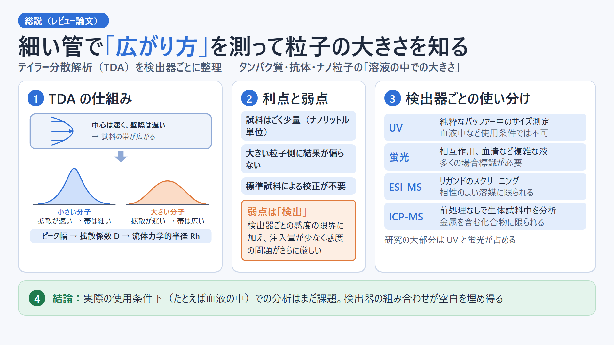

# 細い管で「広がり方」を測って粒子の大きさを知る — テイラー分散解析（TDA）を検出器ごとに整理した総説

## この論文のひとことまとめ

この論文は、タンパク質・抗体・ナノ粒子・薬を運ぶナノキャリアなどの「溶液の中での大きさ」を測る手法、テイラー分散解析（Taylor Dispersion Analysis, TDA）についての総説（レビュー論文）です。新しい手法や実験を提案するものではありません。TDA と組み合わせて使われてきた検出器（UV、屈折率系、SPR、伝導度、蛍光、ICP-MS、ESI-MS、多重検出）ごとに過去の研究を整理しています。そのうえで、「何を知りたいか」によって選ぶべき検出器がどう変わるかをまとめています。なお、著者自身が「網羅的なレビューではない」と明記しています。

## なぜこの研究が重要か

医薬品は、昔ながらの低分子薬だけではなくなりました。ペプチドやタンパク質、モノクローナル抗体、抗体薬物複合体（ADC）、mRNA などの核酸医薬、金属ナノ粒子、脂質ナノ粒子やリポソームといった薬物送達システム（DDS）へと多様化しています。

こうした薬では「大きさ」がとても重要なパラメータです。大きさによって、体内のバリアを通れるか、体のどこに分布するか、腎臓からどれだけ早く排出されるかが変わります。小さいことは安全面で大切ですが、排出が速すぎると標的に作用する時間が足りなくなることもあります。

大きさの測定は、品質の監視にも使われます。たとえばタンパク質が凝集（くっついて塊になること）すると、免疫反応を引き起こすおそれがあります。そのため製造のあらゆる段階で監視が必要です。また、大きさの変化から、薬と抗体がどれくらい強く結合するか（親和定数）を求める研究も多くあります。

## 背景：何が問題だったのか

### 2 種類の「大きさ」

論文はまず、大きさには 2 種類あると整理しています。1 つは電子顕微鏡（TEM）で測る、物理的に占める「実際の」大きさです。もう 1 つは、液体の中で実際にふるまうときの実効的な大きさで、流体力学的サイズ（hydrodynamic size）と呼ばれます。粒子のまわりに溶媒がまとわりつく度合いなどで、両者は大きく異なることがあります。生体内での挙動を考えるうえでは、後者が最も関連性が高いとされています。

### 既存のサイズ測定法とその弱点

流体力学的サイズを測る方法はいくつもあります。論文が挙げる主なものは次のとおりです。

- **サイズで分離する方法**: サイズ排除クロマトグラフィー（SEC）は 100〜200 nm 以下が対象です。フィールドフロー分画（特に非対称流フィールドフロー分画、AF4）はもっと大きな対象（数十 µm オーダー）に使えます。ただしどちらもサイズの標準試料が必要で、カラムや膜との相互作用で試料が失われることがあります。
- **動的光散乱（DLS, Dynamic Light Scattering）**: 水系の溶液では堅牢で日常的に使われ、装置も普及しています。一方で、散乱の強さが半径の 6 乗に比例するため、大きな凝集体が少しでもあると平均サイズが大きい側に引っ張られます。目的の物質以外の信号も拾ってしまうため、血液のような生体媒体での測定は極めて難しいとされます。
- **ナノ粒子トラッキング解析（NTA）**: 粒子を 1 個ずつカメラで追えるので DLS より分解能が高いものの、測れるサイズ範囲が限られ、特に小さい側が苦手です。
- **蛍光相関分光（FCS）/ 蛍光相互相関分光（FCCS）**: 蛍光の揺らぎから測ります。蛍光体や蛍光標識が必要です。
- **拡散 NMR（DOSY）**: 測定時間が比較的長く、ナノ粒子では感度の低さが致命的になり得ます。

### TDA の利点と、残された弱点

こうした中で TDA には次のような利点があると整理されています。

- 試料がごく少量（ナノリットル単位）で済む。
- 混ざりものがあっても、大きい粒子側に結果が偏らない。
- 標準試料を使った校正が要らない。
- 多くの種類の検出器と比較的簡単に組み合わせられる。

一方で、検出が TDA の大きな弱点の一つだと論文は指摘します。検出器ごとに感度の限界があり、そのうえ注入する試料が非常に少ないため、感度の問題がさらに厳しくなるからです。本総説が「検出器」に焦点を当てているのはこのためです。

## 提案手法：何をしたのか

本論文は総説なので、新しい手法はありません。ここでは、レビューの進め方と、論文が解説している TDA の仕組みを紹介します。

### レビューの進め方

- 対象は英語の学術誌に掲載された論文のみで、データ収集期間は 2026 年 6 月 1 日〜9 月 14 日です。
- Web of Science で「Taylor Dispersion Analysis」「Flow-Induced Dispersion Analysis」というキーワードで集め、無関係な分野を除きました。
- 市販装置メーカー（Malvern、Fidabio、Nanoscalemetrix）のサイト情報も統合し、重複を除いています。アプリケーションノートは含めていません。
- 著者 2 名がそれぞれ独立に論文を選び、意見が分かれたものは協議で決めました。
- 採用条件は「TDA の検出に何らかの形で関わる」か「生物医薬分野での用途が明記されている」のどちらかを満たすことです。

### TDA の仕組み：細い管の中の「広がり方」を見る

TDA の土台は、1953 年に Sir Geoffrey Taylor が記述したテイラー分散（Taylor dispersion）という現象です。

細い管（キャピラリー）に液体をゆっくり流すと、流れは層流になり、速度は放物線状の分布になります。管の中心がいちばん速く、壁際はほとんど止まっています。ここに試料を少しだけ注入すると、中心にいる分子は先へ進み、壁際の分子は取り残されます。

ただし分子は、管の半径方向にも拡散（ランダムに動き回ること）します。中心の分子は壁側に移って減速し、壁側の分子は中心へ移って加速します。この結果、各分子の速度は平均速度のまわりで揺れ動き、試料の帯は一定の規則で広がっていきます。

ポイントは、**拡散が速い小さな分子ほど帯は細く、拡散が遅い大きな分子ほど帯は広くなる**ことです。出口で検出される信号はガウス型（釣り鐘型）のピークになり、「テイラーグラム（taylorgram）」と呼ばれます。このピークの幅から拡散係数 D を求めます。

求めた拡散係数は、ストークス–アインシュタイン式（Stokes–Einstein equation）D = k_B T/(6πηRh) で流体力学的半径 Rh に換算します。式中の k_B はボルツマン定数、T は温度、η は溶媒の粘度（粘り気）を表します。つまり、測定時の温度と溶媒の粘度が分かっていれば、拡散係数から半径が一つに決まります。ここで Rh は「その拡散係数をもつ球の半径」として定義されます。つまり TDA は、大きさそのものを見るのではなく、**液中での動きやすさから大きさを逆算する**方法です。

この解析が成り立つには条件があります。論文は、流れによる運搬（移流）と拡散の比を表す無次元数であるペクレ数（Péclet number）が 40 以上であること、無次元化した拡散時間が 2.5 以上であることを挙げています。

大きさの異なる成分が混ざっている場合、信号は複数のガウス型ピークの重ね合わせになります。適切なデータ処理をすれば、多分散試料（大きさがばらばらな試料）の分布全体を得られることも先行研究で示されています。

### 変法：FIDA

TDA の変法として FIDA（Flow-Induced Dispersion Analysis）も紹介されています。これは小さな結合相手（プローブ）を、大きな生体分子を含む液に注入する方法です。プローブが相手に結合すると、見かけの拡散係数が変わります。この変化を相互作用の指標として使い、速い生体分子間相互作用の研究に向いています。たとえば、抗体が小さなプローブを認識する性質を利用して、抗体の濃度を求める例が示されています。

## 結果：何が分かったのか

総説のため独自の実験結果はありません。ここでは、検出器ごとに整理された先行研究の知見を紹介します。

### UV 検出：最も普及しているが、測れる物質が限られる

UV（紫外吸収）検出器は、市販のキャピラリー電気泳動装置のものをそのまま使えるため、広く普及しています。ポリマー、ペプチドやタンパク質、アミロイド凝集体、DNA 複合体、ナノ粒子、mRNA を包んだ脂質ナノ粒子、造影剤などに使われてきました。論文の表には、mRNA 封入脂質ナノ粒子で流体力学的直径 86 nm、Gd 系造影剤で 1〜2.2 nm といった代表例がまとめられています。

主な限界は、UV をよく吸収する分子が少ないことです。そのため、性質のよく分かったバッファー（緩衝液）中で、比較的高い濃度の試料を測る用途が中心になります。感度を上げる工夫として、次のものが挙げられています。

- 小さな試料帯を注入する通常の方式（プラグ注入）ではなく「フロンタルモード」を使い、希釈の影響を避ける。
- 流速を下げる。ただし検出限界はわずかしか下がらず、分析時間が延びる。
- 検出の直前に化学的な処理（誘導体化）を施す。炭水化物の検出例があるが、液を高い pH（約 12〜13）にする必要がある。

### UV を吸収しない物質向けの検出器

- **屈折率（RI）検出**: ほぼすべての物質で信号が出ますが、溶液全体の性質を見るため特定の溶質を区別できず、混合物の測定やキャピラリー TDA には向きません。
- **後方散乱干渉法（BSI, Backscattering Interferometry）**: 屈折率の変化を光学的に捉え、キャピラリー上で測れます。UV を吸収しない多糖類を分析できましたが、感度は比較的低く、フロンタルモードでの検出限界は約 50〜80 mg/L と報告されています。
- **表面プラズモン共鳴（SPR）を使う D-SPR**: 市販 SPR 装置の導入管を長くするだけで、そこでテイラー分散を起こせます。インスリンやアルブミンなどの拡散係数が求められています。ただし SPR はセンサー表面近く（約 100〜200 nm）の液を見ているため、真の「溶液全体」の測定とはみなせないという指摘があります。
- **非接触伝導度検出（C4D）**: 電気を帯びた物質に向きます。ただし実用上は、モル質量 10⁵ g/mol 未満の高分子電解質に限られるとされます。

これらを組み合わせれば多くの物質を測れますが、一般に高濃度で、純粋なバッファー中で測ることが前提になります。

### 蛍光検出：選択性が高く、複雑な液でも測れる

蛍光検出は最も高感度な光学検出法の一つで、TDA 用の市販装置にも搭載されています。ただし、試料が自ら光るか、蛍光標識（タグ）を付ける必要があります。標識そのものが大きさを変えてしまうおそれもあります。実際、アミロイドペプチドに付けた標識が凝集の過程を変えた例や、細胞外小胞（EV）で標識操作がサイズ変化を招き得るという例が紹介されています。

一方で、狙った物質だけを見られる（選択性が高い）ため、血漿や希釈した血清、発酵液のような複雑な液でも測定できます。85% 血清を使っても精度にほとんど影響しなかったという研究もあります（ただし論文中の表では同じ研究の媒体が「85% plasma（血漿）」と記されており、表記が揺れています）。こうした性質から、蛍光 TDA は相互作用を調べる製薬分野の日常的な手法になりつつあるとされます。用途は、バイオマーカーの定量、親和定数の決定、ナノ粒子表面にタンパク質がまとわりつく「プロテインコロナ」の形成評価などです。

### ICP-MS：金属を含む粒子なら生体試料のまま測れる

誘導結合プラズマ質量分析（ICP-MS）は、元素を見分けて検出する方法です。標識は不要ですが、金属を含む化合物やナノ粒子に限られます。市販の接続部品がないこともあり、報告は数件にとどまります。

それでも、UV で測った値との一致は非常に良好です。また装置の堅牢さから、生体試料の影響（マトリックス効果）を乗り越えられます。Gd 系ナノ粒子の大きさを血清・尿・脳脊髄液の中で希釈せずに測った例や、最大 50 mg/mL のタンパク質を含む液で金ナノ粒子のプロテインコロナ形成を評価した例があります。

### ESI-MS：複数の成分を同時に見分けられる

エレクトロスプレーイオン化質量分析（ESI-MS）は、標識なしで選択性と感度を両立し、複数成分を同時に測れる（多重測定）のが最大の利点です。

ただしタンパク質のサイズ測定の報告は非常に少数です。ピークの中心で信号が抑えられる「イオンサプレッション」が原因と考えられています。これに対し、解析の際に該当部分を除外する工夫を入れ、半径 0.5〜5 nm のタンパク質で蛍光 TDA の値と非常に良い相関（0.99）を得た研究があります。また、蛍光検出では平均の大きさしか分からなかったタンパク質（コンカナバリン A）で、二量体と四量体の大きさを別々に測れた例も紹介されています。

制約は、質量分析と相性のよい液（酢酸アンモニウムなど）しか使えないことです。逆にこの性質を利用し、TDA を塩を取り除く前処理（オンライン脱塩）として使い、リガンド候補のスクリーニングに応用した研究もあります。ただし対象は中〜高親和性のリガンドに限られます。

### 多重検出：複数の視点を組み合わせる

検出器の使い方には 2 通りの「多重化」があります。

- **同じ検出器をキャピラリー上の複数地点に置く**: 注入量や圧力の立ち上がりなどに由来する誤差を取り除け、大きな試料体積を注入する場合は必須とされます。3D プリンティングを使って市販装置に二重蛍光検出を組み込み、フルオレセインで検出限界 600 pM を達成した例があります。ただし励起光源をレーザーから LED に替えると感度が大きく下がったという報告もあります。
- **種類の違う検出器を組み合わせる**: 互いに独立した情報が同時に得られます。たとえば、UV と蛍光を組み合わせたタンパク質（HSA）の研究では、蛍光では追えない変化を UV が捉え、4 M 尿素でタンパク質がほどけ始める（アンフォールディング）ことを示しました。また UV と蛍光を組み合わせて、脂質ナノ粒子に封入された mRNA の割合と、分解された mRNA の割合を求めた研究もあります。

### 目的別の使い分け

論文は最後に、検出器と分析目的の対応を表にまとめています。要点は次のとおりです。

| 検出器 | 向いている用途 | 主な制約 |
|---|---|---|
| UV | 標識なしで、純粋なバッファー中のサイズ測定。保管中の医薬品の品質管理 | 選択性がなく、血液中など使用条件での分析はできない |
| 蛍光 | 相互作用の研究、血清など複雑な液での測定 | 多くの場合標識が必要で、標識が大きさや性質を変え得る |
| ESI-MS | リガンドのスクリーニングなどの基礎研究 | 質量分析と相性のよい溶媒に限られる |
| ICP-MS | 前処理なしでの生体試料中の分析 | 金属を含む化合物に限られる |

研究の大部分は UV と蛍光が占めているとされます。

## 意義と限界

論文の結論は、**生物医薬品の産業には、製品を実際の使用条件下（たとえば体内の血液の中）で分析する有効な方法がまだない**というものです。強い蛍光をもつ化合物や金属を含む化合物など特定の種類については TDA による解決策が検討されてきましたが、研究はまだ限られています。より複雑な液での分析を可能にするには、さらに大きな努力が必要だとしています。

そのうえで著者らは、TDA とさまざまな検出器の組み合わせが、堅牢で選択的な新しい分析法を開き、他の手法では埋められない空白を埋め得ると述べています。展望として、パーキンソン病やアルツハイマー病などで注目される金属の異常な分布について、TDA と ICP-MS を組み合わせて調べられる可能性も挙げています。

限界・注意点としては、次のものが論文で示されています。

- 検出器どうしの感度を直接比べるのは難しい。感度は物質の性質や分析条件に加え、物質の大きさにも左右され、その大きさは研究ごとに大きく異なるためです。
- 複数の検出器を同時に使うと、個々の検出法の利点（低濃度や複雑な混合物を測れることなど）が打ち消されることがある。
- 本総説は網羅的ではなく、英語の学術誌論文のみを対象とし、アプリケーションノートは除外している。

## まとめ

テイラー分散解析（TDA）は、細い管の中で試料が広がる様子から、粒子の液中での大きさを少量・校正不要で測る方法です。この総説は、その弱点である「検出」に注目し、UV・蛍光・質量分析など検出器ごとに何ができて何が苦手かを整理しました。実際の使用条件下での分析はまだ課題として残っており、検出器の組み合わせがその突破口になり得るというのが著者らの見立てです。

## 用語集

- **テイラー分散解析（Taylor Dispersion Analysis, TDA）**: 細い管の層流で試料帯が広がる現象（テイラー分散）を利用し、ピーク幅から拡散係数を求めて大きさに換算する手法。
- **流体力学的半径（hydrodynamic radius, Rh）**: 液中での実効的な大きさ。その拡散係数をもつ球の半径として定義される。
- **テイラーグラム（taylorgram）**: TDA で検出されるガウス型（釣り鐘型）のピーク信号。
- **ストークス–アインシュタイン式（Stokes–Einstein equation）**: 拡散係数と流体力学的半径を結びつける式（D = k_B T/(6πηRh)。k_B はボルツマン定数、T は温度、η は溶媒の粘度）。
- **ペクレ数（Péclet number）**: 流れによる運搬と拡散の比を表す無次元数。TDA が成り立つ条件の一つに使われる。
- **FIDA（Flow-Induced Dispersion Analysis）**: TDA の変法。小さなプローブの見かけの拡散係数の変化から、結合や相互作用を測る。
- **フロンタルモード（frontal mode）**: 小さな試料帯を注入する通常の方式（プラグ注入）に対し、希釈の影響を避けて感度を上げる注入方式。
- **プロテインコロナ（protein corona）**: 生体の液中でナノ粒子の表面にまとわりつくタンパク質の層。
- **イオンサプレッション（ion suppression）**: ESI-MS で、ピーク中心など成分が濃い部分の信号が抑えられてしまう現象。

## 原論文

- Unlocking the Full Potential of Taylor Dispersion Analysis Through Advanced Detection（https://arxiv.org/abs/2610.30039）
