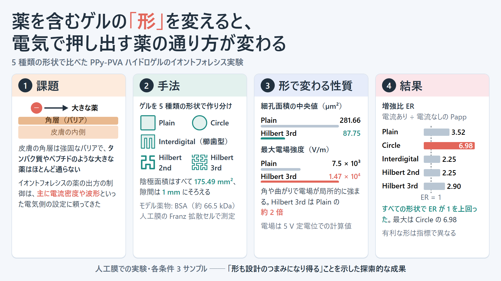

# 薬を含むゲルの「形」を変えると、電気で押し出す薬の通り方が変わる — 5 種類の形状で比べた PPy-PVA ハイドロゲルのイオントフォレシス実験

## この論文のひとことまとめ

皮膚に貼って微弱な電流で薬を送り込む「イオントフォレシス（iontophoresis）」では、これまで主に電流の強さや波形を調整して薬の出方を制御してきました。本論文は、電流ではなく「薬を含んだゲルの形」を変えるという別の手がかりに注目しています。Cornell University の研究チームは、導電性のハイドロゲルを 5 種類の形状で作り分け、形によってゲル内部の細孔の様子と局所的な電場の強さが変わることを確かめました。そのうえで、人工膜を使った実験で、同じ電流条件でも形状ごとに薬の透過特性が異なることを示しています。

## なぜこの研究が重要か

飲み薬や注射ではなく、皮膚から薬を届ける「経皮薬物送達（transdermal drug delivery）」は、体への負担が小さく、決められた通りに薬を使い続けやすいという利点があります。一方で、皮膚の一番外側にある角層（stratum corneum）は強固なバリアで、特にタンパク質やペプチドのような大きな薬はほとんど通りません。

イオントフォレシスは、この壁を電気の力で越えようとする方法です。ただし薬の出方の制御は、主に電流密度や波形といった電気側の設定に頼ってきました。論文は、ゲルそのものの構造を作り込んで制御する方向は比較的手つかずだったと指摘しています。もし「形」で送達特性を変えられるなら、電流を個別に細かく調整しなくても、既存の手法を補う設計の選択肢が増えることになります。

## 背景：何が問題だったのか

イオントフォレシスでは、微弱な定電流またはパルス電流で電場を作り、電荷を帯びた薬の分子を皮膚の中へ動かします。文献で使われる電流密度は 5 µA cm^-2 から 3 mA cm^-2 まで幅があります。

このときのイオンの流れは Nernst-Planck 式で表されます。これは、イオンの流れを「濃度の差による拡散」「電位の差による移動（電気泳動、electromigration）」「液体の流れによる運搬（対流）」の 3 つの和として書く式です。つまり、薬の通りやすさは、薬が通り抜ける道の構造と、そこにかかる電場の強さに左右されます。

もう一つの背景は、ゲルの作り方です。本研究では、化学的な架橋剤を使わずに凍結と融解を繰り返してゲル化させる「凍結融解（freeze-thaw, F/T）物理架橋」を用います。この方法では、氷ができて溶ける過程が細孔を作ります。鋳型の中では体積の膨張が内部応力を生むため、できあがるゲルは形状の影響を受けやすいことが知られていました。それでも、鋳型の形がゲルの微細構造や薬の送達性能にどう効くのかは、他の作製条件に比べて調べられていませんでした。

## 提案手法：何をしたのか

### 中核となる仮説

著者らの仮説は、「鋳型が決めるゲルの形」が間接的な調整つまみになる、というものです。形が変わると、Nernst-Planck 式に現れる 2 つの性質、すなわち (1) ゲル内部の細孔構造と (2) 局所的な電場の強さが変わり、その結果として薬の出方が変わるはずだ、という考え方です。

電場については、物理の基本的な性質を利用しています。導体の鋭い角やエッジ、曲がりの急な部分には電荷が集まりやすく、そこで電場が局所的に強くなります。そこで角を多く作れる形として、空間を埋め尽くすように折れ曲がるフラクタル図形「Hilbert 曲線（原文表記は "Hilbert-Piano curves"）」を電極の形に取り入れました。

### 材料

- **ゲル**: 導電性ポリマーのポリピロール（polypyrrole, PPy）を、ポリビニルアルコール（polyvinyl alcohol, PVA）と混ぜた複合ハイドロゲルです。両者を混ぜることで、機械的に強く、イオンを通す導電性も持つゲルになります。
- **モデル薬物**: ウシ血清アルブミン（bovine serum albumin, BSA）を使いました。分子量約 66.5 kDa の球状タンパク質で、インスリンなどの大きな治療用タンパク質の代わりとしてよく用いられます。
- **作製**: PPy のナノ粒子と PVA を混ぜ、BSA を加えて鋳型に流し込み、凍結 24 時間と融解 24 時間を 1 サイクルとして 3 サイクル繰り返します。

### 5 種類の形状

面積の外枠をそろえたうえで、曲率と角の多さが異なる 5 つの形を用意しました。

- **Plain**: 最も基本的な平面形状。
- **Circle**: 円形。Plain とともに市販のイオントフォレシス装置で最も一般的な電極構成です。
- **Interdigital（櫛歯型）**: 静電気で物を吸着させる装置（電気吸着アクチュエータ）で電場を強めるために使われる形に着想したものです。
- **Hilbert 2nd / Hilbert 3rd**: Hilbert 曲線から導いた形で、2 段階の複雑さ（原文では 2nd と 3rd）を用意しています。

公平に比べるため、薬を含む陰極側の面積はすべて 175.49 mm^2、陰極と陽極の隙間はすべて 1 mm にそろえました。デバイスは、薬を含むゲル（陰極側）、銀/塩化銀（Ag/AgCl）ペーストの電極（陽極側）、蒸発を防ぎ形を保つためのシリコーン樹脂（PDMS）の枠で構成されます。

### 評価の流れ

1. **配合の最適化**: PPy の割合、BSA の濃度、電流密度を一つずつ変えて、最も良い条件を選びます。
2. **微細構造の観察**: ゲルを凍結乾燥して断面を電子顕微鏡（SEM）で撮影し、細孔の面積と空隙率（porosity、断面に占める細孔の割合）を求めます。
3. **電場のシミュレーション**: 有限要素解析（Ansys Maxwell）で、5 V の電位差をかけたときの最大電場強度を計算します。
4. **薬の透過実験**: 「Franz 拡散セル（Franz diffusion cell）」という、膜を挟んだ 2 つの部屋の間で物質の透過量を測る装置を使います。膜には皮膚ではなくセルロースアセテートの人工膜を用い、37 ℃で 180 分まで測定しました。電流をかける条件（IP）と、電流をかけず自然な拡散だけに任せる条件（P）を比べています。

透過のしやすさは主に次の指標で評価しています。

- 累積透過量 Q: 単位面積あたりに膜を通り抜けた薬の総量。
- 擬定常流束 Jss: 透過量がほぼ一定の速さで増える区間での、単位時間あたりの透過量。
- 見かけの透過係数 Papp: Jss をゲル内の初期濃度で割って求める、通りやすさの指標。
- 増強比（enhancement ratio, ER）: 電流ありの Papp を電流なしの Papp で割った値。1 より大きければ電流が透過を後押ししたことを意味します。

なお、PPy と BSA は紫外線の吸収波長が重なるため、そのままでは濃度を区別できません。そこで、測定したスペクトルを両者の成分の足し合わせとして分解する手法（非負最小二乗法、NNLS によるスペクトル分離）で、それぞれの濃度を推定しています。

## 結果：何が分かったのか

### 配合条件

- PPy の割合は 60 wt% が、高い導電率とばらつきの小ささの釣り合いが最も良い条件でした。80 wt% と 90 wt% ではゲルになりませんでした。
- BSA の封入効率（仕込んだ量のうち実際にゲルに取り込まれた割合）は、20 mg mL^-1 のとき 91.2 ± 9.0% で最大でした。
- BSA は体内に近い pH で負の電荷を帯び、陽極側へ移動します。電流密度 2 mA cm^-2 で移動量が最大（1112 µg cm^-2）となったため、透過実験にはこの条件を採用しました。
- 赤外分光（FTIR）の結果からは、BSA がゲルの中でも本来の構造を保っていることが示唆されました。

### 形状ごとの微細構造と電場

| 形状 | 細孔面積の中央値（µm^2） | バルク空隙率（%） | 最大電場強度（V/m） |
|---|---|---|---|
| Plain | 281.66 | 32.78 | 7.5 × 10^3 |
| Circle | 195.06 | 28.75 | 1.14 × 10^4 |
| Interdigital | 106.08 | 19.23 | 1.26 × 10^4 |
| Hilbert 2nd | 234.37 | 34.79 | 1.32 × 10^4 |
| Hilbert 3rd | 87.75 | 30.37 | 1.47 × 10^4 |

細孔の大きさは形によってはっきり異なりました。Plain が最も大きく、Hilbert 3rd が最も小さく、Hilbert 3rd はばらつきも最小で、より均一な構造でした。空隙率は Hilbert 2nd と Plain が高く、Interdigital が最低でした。また、同じゲルの中でも、幅の狭い部分と広い部分で空隙率が大きく違う形状が多く見られました。たとえば Hilbert 2nd では、局所的な空隙率が 37.2% の部分と 2.8% の部分がありました。

電場のシミュレーションでは、角や曲がりの多い 4 形状で電場が局所的に強まる「ホットスポット」が現れました。最大電場強度は Hilbert 3rd が最も高く、Plain の約 2 倍でした。ただし、このシミュレーションはゲル内部を均質と仮定し、5 V の定電位で計算しています。実際の透過実験は 2 mA cm^-2 の定電流で行っており、条件が同じではない点に注意が必要です。

### 薬の透過

| 形状 | Q：電流あり（µg cm^-2） | Q：電流なし（µg cm^-2） | Jss：電流あり（µg cm^-2 h^-1） | ER |
|---|---|---|---|---|
| Plain | 3883 | 3086 | 4602 | 3.52 |
| Circle | 3012 | 820.8 | 3788 | 6.98 |
| Interdigital | 1453 | 1708 | 1346 | 2.25 |
| Hilbert 2nd | 3576 | 3262 | 2052 | 2.25 |
| Hilbert 3rd | 2872 | 1907 | 1891 | 2.90 |

（Q は 3 時間後の累積量で、各形状 3 サンプルの平均値。ばらつきの大きさは後述の通りです）

- **電流をかけると全体として透過が増えました。** 5 形状の平均の累積透過量は、電流ありで 2959 ± 937、電流なしで 2158 ± 1016 µg cm^-2 でした。平均の Papp も、電流ありが (3.80 ± 1.93) × 10^-5 cm s^-1、電流なしが (1.11 ± 0.44) × 10^-5 cm s^-1 です。
- **増強比 ER はすべての形状で 1 を上回りました。** 最大は Circle の 6.98 でした。
- **Hilbert 2nd** は高い電場強度と比較的高い空隙率をあわせ持ち、累積透過量も最も高い部類でした。
- **Interdigital** は、電流なしの方が累積透過量が多かった唯一の形状でした。空隙率が最も低かった形状でもあります。それでも ER が 1 を上回るのは、ER が 3 時間後の総量 Q ではなく、一定速度で透過する区間の流束 Jss から求めた Papp の比だからです。Interdigital の Jss は電流ありで 1346、電流なしで 597 µg cm^-2 h^-1 と電流ありの方が高く、そのため Q の大小と ER の向きが一致しない結果になっています。
- **Hilbert 3rd** は、電場強度は最大でしたが一定速度の流束 Jss は低めでした。著者らは、一定の速さで透過する区間が短いためと考え、総量は多くても長時間一定量を投与する用途には予測しにくいと解釈しています。
- 電流なしの条件では Plain の流束が最大で、空隙率の高さや細孔の大きさとの関連が示唆されました。
- どの条件でも、透過が始まるまでの遅れ（ラグタイム）は最長でも約 5 分と小さく、輸送はほぼ開始直後から始まっていました。

著者らは、電流ありの平均 Papp が、先行研究で報告されたペプチドや、より小さく動きやすいニコチンの値より高かったと述べています。ただし、先行研究の一部は切除したヒトの皮膚を使っており、本研究は人工膜を使っているため、この差は膜の違いによる可能性があると著者自身が付記しています。

形状ごとの性質と透過指標の関係は順位相関（Spearman 相関）でも調べていますが、形状数が 5 つしかないため信頼区間が非常に広く、著者らは「定性的な傾向」「探索的」な分析と位置づけています。

## 意義と限界

この研究の意義は、イオントフォレシスの薬の出方を、電流の設定だけでなく「ゲルの形」でも調整できる可能性を示した点にあります。著者らは、形状による制御は個別の電流密度制御を必要とせずに既存の手法を補完できるとし、大きな分子の薬を届けるゲル型経皮システムの設計指針になると述べています。形が細孔構造と電場の両方を同時に変えるという視点も、設計の考え方として示唆的です。

一方で、論文は多くの限界を自ら挙げています。

- **サンプル数が少なく、ばらつきが大きい**: 各条件 3 サンプルで、特に電流なしの累積量や電流ありの流束のばらつきが大きくなっています。物理架橋の過程に由来する可能性があり、形状による差は探索的な結果として、より多くのサンプルでの確認が必要とされています。
- **人工膜での結果である**: 人工膜と実際の皮膚は構造も輸送の性質も大きく異なり、結果を生体の皮膚にそのまま当てはめることはできません。
- **シミュレーションと実態のずれ**: シミュレーションは角で電場が最大になると予測しますが、SEM では端の近くに緻密な壁のような表面層ができており、イオンの移動を妨げる可能性があります。計算上の高い電場が、実際に効いている電場の強さを意味するとは限りません。
- **SEM は各形状 1 試料のみ**: 試料ごとのばらつきは捉えられていません。
- **電流密度は安全基準ではない**: 実験の電流密度は透過量を最大化する目的で選んだもので、生体での安全な上限とみなすべきではありません。高い電流密度は組織を傷めるおそれがあります。

今後の課題として、化学架橋による網目構造の利用、実際に効いている電場強度の定量、X 線 CT による細孔のつながりや曲がり具合の 3 次元評価が挙げられています。生体での使用に向けては、皮膚の電気抵抗に応じた電流密度や電極間隔の調整、漏れを防ぎ水分を保つ粘着性の枠の改良も必要とされています。

## まとめ

本論文は、凍結融解で作る導電性ハイドロゲルの形を 5 種類に変えることで、ゲル内部の細孔構造と局所電場が変わり、薬の透過特性が形状ごとに異なることを人工膜の実験で示しました。電流をかけるとすべての形状で透過が後押しされましたが、どの形が有利かは指標によって異なります。サンプル数や人工膜という制約があるため、現時点では「形も設計のつまみになり得る」ことを示した探索的な成果と捉えるのが妥当です。

## 用語集

- **イオントフォレシス（iontophoresis）**: 微弱な電流で電場を作り、電荷を帯びた薬を皮膚に透過させる方法。
- **角層（stratum corneum）**: 皮膚の一番外側の層。多くの薬に対して強いバリアになる。
- **Nernst-Planck 式**: イオンの流れを、拡散・電位差による移動・液体の流れによる運搬の和として表す式。
- **凍結融解（freeze-thaw）物理架橋**: 化学架橋剤を使わず、凍結と融解を繰り返して PVA をゲル化させる方法。氷の形成と融解が細孔を作る。
- **Hilbert 曲線**: 空間を埋め尽くすように折れ曲がるフラクタル曲線。角が多く、電場を局所的に集中させるのに使われた。
- **Franz 拡散セル（Franz diffusion cell）**: 膜を挟んだ 2 つの部屋の間で、物質がどれだけ透過したかを測る実験装置。
- **見かけの透過係数（Papp）**: 一定速度での透過量をゲル内の初期濃度で割った、通りやすさの指標。
- **増強比（enhancement ratio, ER）**: 電流ありの Papp を電流なしの Papp で割った値。

## 原論文

- Geometry-Dependent Properties of Physically Crosslinked PPy-PVA Hydrogels Enable Tunable Iontophoretic Drug Delivery（https://arxiv.org/abs/2610.31567）
