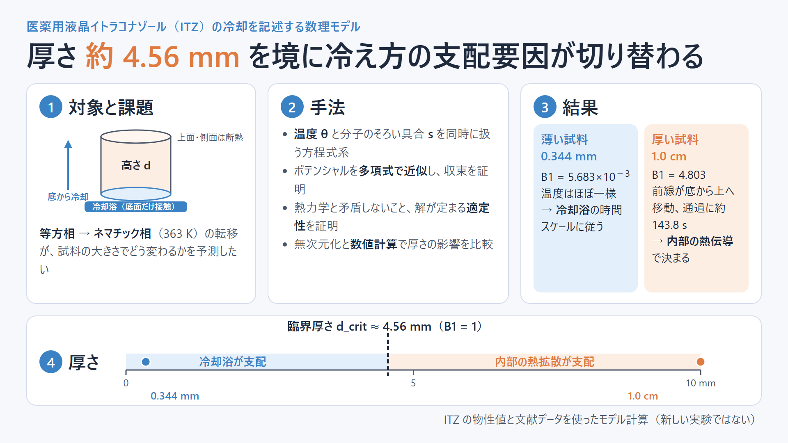

# 薬の液晶を冷やすとき、試料の「厚さ」で何が変わるのか — 臨界厚さ約 4.56 mm を境に冷え方の支配要因が切り替わる数理モデル

## この論文のひとことまとめ

医薬用の液晶性化合物イトラコナゾール（itraconazole, ITZ）を底から冷やしたときに、分子の向きがそろっていく相転移を数理モデルで記述した研究です。著者らは、温度と分子の向きの変化を同時に扱う方程式系を立てました。そのうえで、方程式が熱力学と矛盾しないことと、数学的に解がきちんと定まることを証明しています。さらにスケーリング解析と数値計算から、試料の厚さが約 4.56 mm（臨界厚さ）を境に、冷え方を支配する要因が「冷却浴」から「試料内部の熱の伝わり方」へ切り替わることを示しました。

## なぜこの研究が重要か

飲み薬の有効成分は、水に溶けやすく体に吸収されやすい形で使う必要があります。そのため従来は、結晶や非晶質（アモルファス）といった固体の形が使われてきました。液晶になる化合物は、こうした医薬材料開発の追加の選択肢として位置づけられています。

液晶材料の加工は、相転移の起こり方と深く結びついています。室温でガラス状の材料を得るには、高温の液体を冷やしていきます。その途中で、分子運動が止まる「速度論的凍結（kinetic arrest）」が起こる前にどの相を通るかは、冷却速度の影響を受けます。つまり「どう冷やすか」が、できあがる材料の状態を左右します。

著者らは、ラボでの評価から工業生産へとスケールを上げると、材料内部の場所ごとの温度履歴が根本的に変わると述べています。本論文は、試料の大きさによって冷え方がどう変わるかを予測する数理的な枠組みを提供することを目指しています。

## 背景：何が問題だったのか

対象の ITZ は、温度によって液晶相が現れるサーモトロピック（thermotropic）な化合物です。ガラスを作りやすい性質も持ち、熱量測定や X 線散乱の実験データがそろっています。文献の示差走査熱量測定（DSC）によると、冷却時の主な転移温度は次のとおりです。

- 等方相→ネマチック相の転移: 363 K
- ネマチック相→スメクチック相の転移: 347 K（十分ゆっくり冷やした場合）
- ガラス転移温度: 328 K

ここで等方相（isotropic phase）は分子の向きがばらばらな液体の状態です。ネマチック相（nematic phase）は、分子の位置はばらばらのまま向きだけがそろった液晶の状態です。本論文が扱うのは、このうち等方相→ネマチック相の転移だけです。

理論面では、分子のそろい具合に応じたエネルギー（バルクポテンシャル）の選び方に課題がありました。

- 多項式で書く Landau–de Gennes ポテンシャルは扱いやすい一方、物理的にありえない状態を排除できません。
- Ball–Majumdar ポテンシャルは、物理的な範囲の端でエネルギーが無限大になり、ありえない状態を自然に排除します。ただし式が陰的にしか与えられないため、解析や計算に使いにくいという弱点があります。

## 提案手法：何をしたのか

### 1. 温度と分子の向きを同時に扱うモデル

土台にしたのは、Ericksen 理論（Ericksen's theory with variable degree of orientation）と呼ばれる液晶の連続体理論です。著者らはこれを温度変化も扱える形（非等温版）に拡張しました。液体全体の流れは無視しています。未知数は次の 3 つです。

- ダイレクタ（director）n: 分子がそろう方向を表す単位ベクトル。
- スカラー秩序パラメータ（scalar order parameter）s: そろい具合を表す数。s = 0 が等方（ばらばら）、s = 1 が完全にそろった状態で、物理的な範囲は −1/2 < s < 1 です。
- 温度 θ。

エネルギーとエントロピーの関係を定め、熱力学第二法則の局所形である Clausius–Duhem 不等式を満たすように方程式を導きました。この結果、分子の向きがそろう変化が熱の方程式に寄与する形になります。また、熱の伝わりやすさ（熱伝導率）は、分子の向きに平行な方向と垂直な方向とで異なるように扱っています。

想定する形は、高さ d の円筒形の試料セルです。底面だけを冷却浴に接触させ、側面と上面は断熱とします。冷却浴の温度は時間とともに一定の速さで下がります。浴との熱のやりとりは、温度差に比例して熱が流れる Newton–Robin 境界条件で表します。側壁で分子の向きを鉛直に固定すると、向きは全体で鉛直のまま変わらない解が得られます。さらに初期値が高さ方向の座標だけに依存する場合、問題は高さ方向だけの s と温度の 1 次元問題に帰着します。

### 2. 扱いにくいポテンシャルを多項式で近似

Ball–Majumdar ポテンシャルを、端で無限大になる「特異な部分」と、なめらかな「残りの部分」に分けました。残りの部分は第一種 Chebyshev 多項式（直交多項式の一種）で近似します。著者らは、この近似が元のポテンシャルに収束することを証明しました。近似しても、転移温度 363 K で 2 つの状態が共存する条件と、端でエネルギーが無限大になる性質は保たれます（Theorem 1）。

### 3. 方程式の解がきちんと定まることの証明

円筒の角を丸めた領域で、解が短い時間なら存在し、ただ 1 つに決まり、初期条件や境界条件に連続的に依存することを証明しました。このような性質を適定性（well-posedness）と呼びます（Theorem 2）。

あわせて、温度が正に保たれている限り、s が物理的な範囲の端（−1/2 や 1）に近づかないことも示しています。そのため、解の大きさ（ノルム）が有限にとどまる場合、有限時間で破綻するとすれば温度の正の下限が失われる形しかありません。

### 4. 無次元化と数値計算

方程式を無次元化して、どの効果が効いているかを比べました。この部分の計算には、扱いやすい多項式の Landau–de Gennes ポテンシャルを使っています。鍵になるのは次の 2 つの数です。

- B1: 試料内部で熱が拡散するのにかかる時間と、冷却浴の温度変化の時間との比。
- Biot 数（Bi）: 境界での熱の受け渡しと、内部での熱伝導の比。

B1 = 1 となる厚さを臨界厚さ d_crit と定義しました。熱拡散率を D_T、冷却浴の基準時間を t0 とすると、d_crit = √(D_T t0) です。

厚い試料では、s の時間・空間変化の項がとても小さくなります。そこで s を温度だけで決まる関数とみなし、相転移の潜熱を取り込んだ「有効熱容量」を持つ 1 本の熱方程式に縮約しました。数値計算では、空間を 150 点の格子で離散化して時間方向の常微分方程式にする線の方法（Method of Lines）を使いました。時間積分には、急激に変化する問題に強い陰的解法 Radau IIA を使っています。

## 結果：何が分かったのか

計算は新しい実験ではなく、ITZ の物性値と文献の DSC・比熱データを使ったモデル計算です。主な物性値と条件は次のとおりです。

- 熱拡散率 D_T ≈ 3.478 × 10^−7 m²/s
- 冷却浴の冷却速度 h = 0.0167 K/s、基準時間 t0 = 59.86 s
- 浴との熱伝達係数 γ = 100 W/(m²K)

これらの値から、臨界厚さは d_crit ≈ 4.56 mm になります。比較したのは、ラボの測定スケールである厚さ 0.344 mm の薄い試料と、厚さ 1.0 cm の厚い試料です。

**薄い試料（d = 0.344 mm）**: B1 = 5.683 × 10^−3 と 1 よりずっと小さくなります。試料内部の熱拡散は浴の冷却に比べてほぼ瞬時に進み、温度は試料内でほぼ一様です（準等温）。転移は冷却浴の時間スケールに従って進みます。また、s が落ち着くまでの初期の時間スケールは、温度のそれより約 10^5 倍短いと見積もられています。

**厚い試料（d = 1.0 cm）**: B1 = 4.803、Bi = 1.25 です。Bi が 1 程度であることは、試料内部の熱抵抗と外部への熱の受け渡しが同程度であることを意味します。熱が拡散する時間スケールは約 287.5 s（約 4.79 分）で、転移の進み方は内部の熱伝導で決まります。

厚い試料では、転移温度に達する位置（転移温度等温線）が底から上へ移動していきます。ヒューリスティックな解析によると、底面から測った高さが上がるほど到達は遅れますが、上面に近づくにつれて遅れの増え方は鈍ります。高さと到達の遅れの関係をグラフにすると、上に凸の放物線になります。熱は底面からしか逃げないため、底付近では速く進みます。一方、断熱された上面に近づくと温度勾配がほぼゼロになり、進みが遅くなります。完全な方程式を数値的に解くと、この前線が 1.0 cm の円筒の高さ全体を通過するのにかかる時間は約 143.8 s（約 2.4 分）でした。なお薄い試料でも、到達時間は近似的に上に凸の二次曲線を示すとされています。

数値計算で得た温度と秩序パラメータの分布（Figure 4）では、最初は全体が等方相です。冷えるにつれて、等方相とネマチック相の不連続な境目が試料内を掃いていきます。最後にこの境目が断熱上面に達し、ネマチック相としての秩序が増していきます。

ただし著者らは重要な留保を付けています。転移温度等温線は、実際の等方相–ネマチック相の境界と一致するとは限りません。準安定性や配向が落ち着く速さの影響で、転移温度を通過した後も s の変化が遅れることがあるためです。論文は、温度だけから見た予測と、配向秩序そのものの発展とを区別して扱っています。

## 意義と限界

この研究は、分子の向きの変化と熱の伝わり方の連成を、熱力学的に矛盾のない形で記述しました。数学的には、Ball–Majumdar ポテンシャルの陽的な近似とその収束、連成問題の局所的な適定性を確立しています。さらに、配向の緩和・熱拡散・外部冷却の時間スケールが大きく離れていることを示しました。熱拡散時間と冷却時間の比較から、2 つの領域を分ける特性厚さも同定しています。著者らは、試料寸法が変わると冷却中の熱履歴が大きく変わりうることを示した点を意義として挙げています。

一方、論文は次の限界を認めています。

- モデルはラボスケールの形状を前提にしています。厚い試料は、熱の長さスケールを変えたときの影響を見るために扱ったものです。工業プロセスへ当てはめるには、このモデルにない物理効果を加える必要があります。
- 液体全体の流れは無視しています。
- 扱うのは等方相→ネマチック相の転移だけで、ネマチック相→スメクチック相の転移は対象外です。
- ITZ の回転粘性は現時点で不明なため、液晶の文献の典型値を使っています。また、転移の近くで比熱が増大する効果は基準値に含めていません。
- 適定性の証明は角を丸めた領域で行っており、角のある実際の円筒での理論は扱っていません。

今後の課題として、スメクチック相への転移を含める拡張が進行中とされています。ITZ では、等方・ネマチック・スメクチックの各相をどの順に通るかが、冷却後の材料状態を決めるうえで重要だからです。そのほか、相の境界の詳しい動き、温度に依存する物性値、核生成の仕組みも挙げられています。

## まとめ

医薬用液晶 ITZ を底から冷やすときの相転移を、温度と分子の向きを連成させた数理モデルで記述し、その数学的な正しさを証明した研究です。解析の結果、厚さ約 4.56 mm を境に、薄い試料では冷却浴が、厚い試料では内部の熱拡散が転移の進み方を支配することが示されました。試料の大きさが変わると熱履歴が大きく変わりうるという指摘は、冷やし方の設計を考える際の手がかりになります。

## 用語集

- **液晶（liquid crystal）**: 液体のように流れつつ、分子の向きにある程度の秩序を持つ状態。温度で液晶相が現れるものをサーモトロピック（thermotropic）と呼びます。
- **等方相（isotropic phase）**: 分子の向きがばらばらな液体の状態。
- **ネマチック相（nematic phase）**: 分子の向きはそろうが、位置には秩序がない液晶相。
- **スカラー秩序パラメータ（scalar order parameter）s**: 分子の向きのそろい具合を表す数。0 が等方、1 が完全にそろった状態。
- **ダイレクタ（director）**: 分子がそろう方向を表す単位ベクトル。
- **速度論的凍結（kinetic arrest）**: 冷却中に分子運動が止まり、相転移が進まないままガラス状態などで固定されること。
- **Biot 数（Biot number）**: 境界での熱の受け渡しと内部の熱伝導の比。
- **臨界厚さ（d_crit）**: 試料内の熱拡散時間と外部冷却の時間が等しくなる厚さ。本論文の条件では約 4.56 mm。
- **適定性（well-posedness）**: 方程式の解が存在し、ただ 1 つに決まり、データに連続的に依存すること。

## 原論文

- Modeling and Analysis of Cooling Induced Isotropic Nematic Transitions in Pharmaceutical Liquid Crystals（https://arxiv.org/abs/2611.00273）
