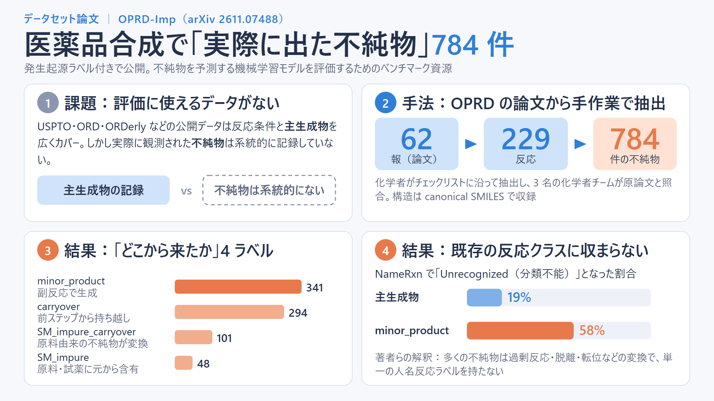

# 医薬品合成で「実際に出た不純物」を集めたデータセット — 784 件に発生起源ラベルを付けた OPRD-Imp

## この論文のひとことまとめ

医薬品の製造プロセスを扱う専門誌 Organic Process Research & Development（OPRD）の論文 62 報から、229 の反応を化学者が手作業で抜き出しました。そこで実験的に観測された不純物 784 件を、分子の構造を表す文字列（SMILES）と「その不純物がどこから来たか」を示す 4 種類のラベル付きで収録したのが、公開データセット OPRD-Imp です。著者らはこれを、不純物を予測する機械学習モデルを評価するためのベンチマーク資源として位置づけています。新しいモデルを提案する論文ではなく、データセットそのものを報告する論文です。

## なぜこの研究が重要か

化学反応では、狙った生成物（主生成物）のほかに、望まない化合物も一緒にできたり混ざり込んだりします。これを不純物（impurity）や副生成物（side product）と呼びます。想定外の不純物は精製を難しくし、収率を下げます。研究段階では、正体不明の化合物が生物実験に持ち込まれ、結果の解釈を曖昧にすることもあります。

医薬品の製造段階では、問題はさらに大きくなります。医薬品規制調和国際会議（ICH）のガイドライン Q3A・Q3B・M7 は、遺伝毒性のあるものを含む不純物を ppm レベルまで管理することを求めています。論文によれば、不純物の同定や管理に失敗すると、承認申請の遅れ、高コストな製造ロットの再処理、販売後のリコールにつながりえます。

ところが、どんな不純物ができるかは熟練した化学者でも予測が難しいとされます。そこで、過去に蓄積された実験の観測結果から、不純物ができるパターンを学ぶデータ駆動型のアプローチが期待されています。本論文は、その土台となるデータを用意する研究です。

## 背景：何が問題だったのか

有機化学向けの機械学習は、反応の生成物を当てる順方向反応予測や、目的の分子から合成経路をさかのぼる逆合成（retrosynthesis）などで成果を上げています。FlowER や Reactron のように、反応を素反応ステップの単位で表す機構的な予測手法も登場し、主生成物の予測を超えつつあります。しかし既存の反応予測ベンチマークの多くは主生成物に焦点を当てており、不純物の予測は相対的に注目されてきませんでした。

論文が「決定的なボトルネック」として挙げるのは、評価に使えるデータがないことです。USPTO（米国特許由来の反応データ）、Open Reaction Database（ORD）、ORDerly といった公開データは、反応条件と主生成物を広くカバーしています。しかし、実際に観測された不純物を系統的に記録してはいません。特許や論文に基づく商用データセットでも、複数の生成物を報告するエントリはごく一部です。このため、副生成物や反応機構を予測するモデルがあっても、厳密に評価できない状況でした。

不純物の構造を実験で確かめるのも手間がかかります。スケールアップ時に不純物を単離して NMR で同定するか、質量分析と反応機構の推論から構造の仮説を立て、別に合成した標品と比べるのが一般的です。網羅的に調べるのは、小さな実験規模でも資源を多く要します。

## 提案手法：何をしたのか

### データ源に OPRD を選んだ理由

著者らは、医薬品プロセス化学（原薬の合成ルートを工業規模で実施できるよう開発・スケールアップする分野）の専門誌である OPRD に着目しました。理由は 3 つです。

- OPRD は原薬（API、医薬品の有効成分）や医薬中間体の合成ルート開発に特化しており、不純物の同定が特に重要な領域である。
- OPRD の論文は、観測された不純物の構造を分析的な根拠とともに詳しく報告するのが通例である。不純物の報告が系統的でない学術合成寄りの雑誌や、不純物データが通常ない特許由来のデータとは対照的である。
- 実際の医薬品合成ワークフローにおける不純物予測に、直接関連する。

### 論文の選び方

OPRD のウェブサイトで "impurity" または "impurity validation" をキーワードに、2000〜2026 年の論文を検索しました（検索は 2026 年 5 月）。採択したのは、著者自身が行った反応ステップを少なくとも 1 つ含み、少なくとも 1 ステップについて不純物の構造が明示されている一次実験データの論文です。総説や計算のみの論文、不純物が名前だけで構造が示されていない論文は除外しました。結果として 62 報（出版年 2002〜2026 年）が採択されています。

### チェックリストに沿った手作業の抽出

抽出は、訓練を受けた化学者が補足資料（Supporting Information）を含む論文 PDF を読んで手作業で行いました。決まった手順がないと、作業者間で判断がぶれたり、一箇所で軽く触れられただけの不純物を見落としたりするため、抽出チェックリストを設計しています。要旨・本文・実験項・すべての表や図・補足資料を必ず確認し、不純物ごとに原論文からの直接引用を根拠として記録させました。

抽出の段階では、定量的に報告されたもの（例: HPLC 面積で 1.2%）、定性的に言及されたもの（例: 微量検出）、「生成は観測されず」と否定的に言及されたもの、暗に言及されたものまで幅広く拾いました。報告のされ方による偏りを抑えるためです。ただし公開データに残したのは、原論文が「実際に観測された」と報告した化合物だけです。

### 不純物の「発生起源」を 4 つに分類

このデータセットの大きな特徴は、各不純物に「どこから来たか」を示すラベルを付けたことです。ラベルは、そのステップから見て最も早く特定できる発生源に基づいて割り当てます。

| ラベル | 意味 |
|---|---|
| minor_product | そのステップの副反応で生成した不純物（選択性の失敗や過剰反応など） |
| SM_impure | そのステップの前から出発原料や試薬に含まれていた不純物で、その反応では生成していないもの |
| SM_impure_carryover | 原料由来の不純物が、そのステップ中に化学変換されてできた不純物 |
| carryover | 前のステップから変換されずに持ち越された不純物（生成物に残った未反応の原料・試薬も含む） |

なお SM_impure は原料の供給に由来するため、反応機構からは予測できません。それでも実際のプロセス化学で観測される不純物の全体像を示すため、収録したと説明されています。ラベルの最終決定は、3 名の専門キュレーターの合意によります。

### 専門家による照合と構造化

3 名の化学者チームが、抽出された各不純物とその引用を原論文と照合しました。根拠のないものや化学的に妥当でないものは、却下または修正しています。残った不純物と、反応の反応物・試薬・溶媒・生成物を構造式に描き起こし、正規化された一意の表記である canonical SMILES に変換しました。立体化学（分子の立体的な配置）は原論文の描画どおりに転記しています。

データは JSON 形式で、同じ論文内の連続する反応ステップを next_reaction_id というフィールドでつなぎ、多段階の合成ルートを表現しています。さらに、持ち越された不純物には parent というフィールドで「親」となる化学種へのパスが記録されています。このパスを繰り返したどれば、ある不純物がどのステップのどの化合物から来たのかを、元の発生源までさかのぼれます。

## 結果：何が分かったのか

### データセットの規模と中身

- 論文 62 報、反応 229、不純物エントリ 784 件。
- 起源別の内訳は、minor_product 341 件、carryover 294 件、SM_impure_carryover 101 件、SM_impure 48 件。
- 1 反応あたりの不純物数は中央値 3、平均 3.4 です。不純物が 10 件以上ある反応も 12 件あります。
- 反応の種類は、アミド結合形成、還元的アミノ化、保護基の着脱、パラジウム触媒クロスカップリング、不斉変換など、医薬品プロセス化学の幅広い範囲にわたります。

データは figshare で CC BY 4.0 ライセンスのもと公開されています。JSON 本体に加え、反応ごとに構造式で閲覧できる単一ファイルの対話的ダッシュボード（HTML）も同梱されています。

### 不純物リストが空の反応

不純物が記録されていない反応もあります。ひとつは、複数ステップを中間体を取り出さずに一つの容器で行うワンポット（one-pot）手順の途中ステップで、9 件あります。もうひとつは、原論文がそのステップの不純物を報告していない 19 件（229 の 8.3%）です。著者らは、この 19 件がいずれも完全転化や 100% 収率を報告していないことを確認しています。不純物が分析前の後処理で除かれたか、単に検出されなかった可能性があるとしています。

### 既存の反応分類ツールで見えた「主生成物と不純物の違い」

著者らは、反応を人名反応などのクラスに自動分類する商用ツール NameRxn で、主生成物 229 と不純物 784 の計 1,013 反応を分類しました。そして、大規模反応データセットの USPTO（約 0.97 M 反応）や Pistachio（約 4.3 M 反応）とクラス分布を比べています。

- 主生成物のクラス分布は、USPTO や Pistachio とほとんど区別できませんでした。
- 不純物は、主生成物に比べて "Resolution"（化学変換のない分離などに相当するクラス）と "Unrecognized"（分類不能）に偏っていました。"Resolution" に分類された不純物 224 件のうち 217 件（97%）は、残った出発原料や試薬でした。
- 主生成物の "Unrecognized" 率が 19% だったのに対し、そのステップの副反応でできた minor_product では 58% が "Unrecognized" でした。

著者らは、"Unrecognized" は化学の新しさだけでなく、分類ツール側のカバー範囲も反映していると解釈しています。多くの不純物は過剰反応・脱離・転位などの変換であり、単一の人名反応ラベルを持たないだけだという見方です。例として、芳香族求核置換反応（SNAr）で 1 回置換すると目的物になり、2 回置換するとビス付加体の不純物ができるケースが挙げられています。後者は正味の二重置換であるため、単一クラスに割り当てられません。

### 技術的な検証

すべての SMILES を化学情報ライブラリ RDKit で読み込み、有効な分子として扱えることを確認しています。164 個の next_reaction_id 参照はすべて正しく解決され、parent パスを持つ 438 件はすべて同じ論文の同じかそれ以前のステップの化学種に解決されました。残りは minor_product 341 件と、発生源が特定できない 5 件です。各論文は合計 3 回以上精査され、そのうち 2 回は元の抽出を担当していないキュレーターが行っています。

## 意義と限界

著者らは OPRD-Imp を、規模よりも「アノテーションの信頼性」を優先して設計したベンチマークと位置づけています。特徴として挙げているのは次の 4 点です。

- 実験で報告され、構造がキュレーションされた不純物アノテーション
- 起源カテゴリ別にモデルを評価できる起源ラベル
- 反応ステップ間の連結と、不純物を発生源までたどれる来歴パス
- すべての生成物・不純物への反応クラス注釈

一方で、論文は次のような限界や利用上の注意を明記しています。

- 不純物リストが空のステップは「報告がない」だけで、「不純物がない」証拠ではありません。負例ではなく未アノテーションとして扱うべきとされています。
- HPLC 面積％などの定量情報は抽出時に取得しましたが、報告の仕方が不均一で不完全なことが多いため、公開データには含めていません。定量情報の組み込みは今後の課題です。
- SM_impure は反応機構から予測できません。
- 規模は 229 反応・784 件で、信頼性を規模より優先した設計です。
- 反応クラス注釈に使った NameRxn は商用ツールです。投入したデータと得られたラベルはデータに保存されており、ライセンス保有者は再現できます。
- 本論文には、既存の反応予測モデルを OPRD-Imp で実際に評価した結果は含まれていません。

## まとめ

OPRD-Imp は、医薬品プロセス化学の論文から実際に観測された不純物 784 件を手作業で集め、発生起源ラベルと来歴パスを付けた公開データセットです。主生成物に偏っていた既存の反応データを補い、不純物予測モデルを評価するための土台を提供します。分類ツールで見ると、副反応由来の不純物の多くが既存の反応クラスに収まらないことも示されました。

## 用語集

- **不純物（impurity）／副生成物（side product）**: 目的の主生成物以外に生じる、または混入する化合物。本データセットでは原論文で観測が報告されたもののみを収録。
- **プロセス化学（process chemistry）**: 医薬品原薬の合成ルートを、工業規模で実施できるよう開発・スケールアップする分野。OPRD はその専門誌。
- **原薬（API, active pharmaceutical ingredient）**: 医薬品の有効成分。
- **SMILES**: 分子構造を 1 行の文字列で表す記法。canonical SMILES は同じ分子に対して一意に決まる正規化表記。
- **carryover（持ち越し）**: 前のステップの不純物や未反応原料が、次のステップに入り込むこと。
- **ワンポット（one-pot）**: 複数の反応ステップを、中間体を取り出さずに一つの容器で行う手順。
- **NameRxn**: NextMove Software の商用反応分類ツール。反応に人名反応などの階層的なクラスを付与する。
- **ICH Q3A / Q3B / M7**: 医薬品規制調和国際会議のガイドライン。新原薬・新製剤の不純物、変異原性不純物の評価と管理を扱う。

## 原論文

- OPRD-Imp: a dataset of experimentally observed impurities and side products in multi-step pharmaceutical syntheses（https://arxiv.org/abs/2611.07488）
