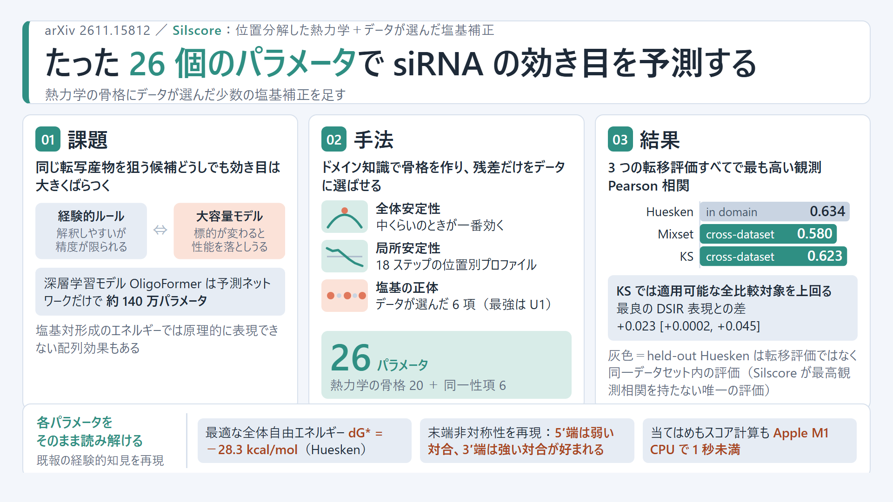

# たった 26 個のパラメータで siRNA の効き目を予測する — 熱力学の骨格にデータが選んだ少数の塩基補正を足す Silscore



## この論文のひとことまとめ

狙った遺伝子の働きを抑える短い RNA（siRNA）は、同じ遺伝子を狙う候補どうしでも効き目が大きく違います。この論文は、効き目（potency）を予測するモデル **Silscore** を提案しました。使う手がかりは次の 3 つだけで、これらを足し合わせた合計 26 パラメータの小さなモデルです。

- 2 本鎖全体の結びつきの強さは、中くらいのときが一番効くという関係
- どの位置で結びつきが弱いほうが有利かを、位置ごとに並べたプロファイル
- それでも説明できない分を補う、少数の「どの塩基が来るか」の補正

訓練に使っていない 3 つの転移評価すべてで最も高い観測相関を示しつつ、各パラメータをそのまま物理的・生物学的に読み解ける点を特徴としています。

## なぜこの研究が重要か

siRNA は「配列を書き換えるだけで標的を変えられる」遺伝子サイレンシング手段です。遺伝子の機能を調べる実験道具としても、病気の原因となる転写産物（mRNA）を抑える治療手段としても使われます。ところが、同じ転写産物を標的にする候補配列の間でも効き目は大きくばらつくため、「どの配列を選ぶか」が設計の中心課題になります。

この予測の分野では、手法が二極化していました。一方は解釈しやすいが精度が限られる経験的ルール、もう一方はデータセットや標的が変わると性能を落としうる大容量モデルです。近年の深層学習モデルの一つである OligoFormer は、予測ネットワークだけで約 140 万個の学習可能パラメータを持ちます。

この論文が面白いのは、機械学習のモデル設計として見たときの構図です。**ドメイン知識（核酸の熱力学）で骨格を作り、そこで説明できなかった残差だけをデータに選ばせる**という方針で、パラメータ数を 26 に抑えたまま、桁違いに大きなモデルと同じ土俵に立っています。さらに「訓練データと似ていない標的に移したとき性能がどれだけ落ちるか」を切り分けて測っており、転移性能の検証の作り方そのものが参考になります。

## 背景：何が問題だったのか

siRNA が働く仕組みから、配列依存性の理由を押さえておきます。siRNA は 2 本鎖（二重鎖）として細胞内に入り、**Argonaute**（アルゴノート）というタンパク質に積み込まれます。このとき 2 本のうち一方だけが「ガイド鎖」として保持され、もう一方は捨てられます。どちらが選ばれるかは二重鎖の両端の相対的な安定さに部分的に左右されます（Khvorova et al. 2003、Schwarz et al. 2003）。積み込まれた後は、ガイド鎖の領域ごとに結合や触媒における役割が違ってきます（Wee et al. 2012）。

そのため熱力学は、初期の経験的な配列・安定性ルール以来、siRNA 設計の一部であり続けました。ただし使い方には歴史があります。Vert et al. [2006] は隣接塩基対のスタッキングエネルギー（隣り合う塩基どうしが重なり合うことで生じる安定化の大きさ）を位置ごとに当てはめたプロファイルを試しましたが、比較した他の配列表現より精度が低い結果でした。一方で、安定すぎる二重鎖を作ると予測されるガイドを除外したり、全体の安定さに「中間的なよい範囲」があることを示した研究もあります（Ichihara et al. 2007、Matveeva et al. 2010）。近年の深層学習モデルは熱力学的な記述子を配列・標的文脈の特徴と組み合わせています（Long et al. 2024、Bai et al. 2024）。つまり熱力学は確かに情報を持っています。

問題は、**塩基対形成のエネルギーでは原理的に表現できない配列効果がある**ことです。はっきりした例はガイド鎖の 5′ 末端（配列の 1 番目）のヌクレオチドで、ここは Argonaute がタンパク質との直接接触によって認識します（Frank et al. 2010）。塩基対の相性ではないので、スタッキングエネルギーをどう並べ替えても表現できません。これが、熱力学プロファイルを骨格にしつつ、少数の「塩基の正体」補正で残りを拾う混成（ハイブリッド）表現の動機になりました。

もう一つの問題は評価です。パラメータの多い柔軟なモデルは実験設計の癖（アーティファクト）まで学習しかねません。また訓練データとテストデータが重複していると、本当に未知の標的に対する性能を過大評価してしまいます。だから転移性能を明示的に検証する必要がある、というのが著者らの立場です。

## 提案手法：何をしたのか

### モデルの形

長さ 19 ヌクレオチドのガイド鎖 g に対し、予測される効力は次の 3 成分の和です（原論文 Equation 1、記号は ASCII 表記）。

```
y_hat(g) = beta0 - kappa * (dG(g) - dG*)^2   ... 全体安定性（global stability）
            + sum_{i=1..18} w_i * dG_i        ... 局所安定性（local stability）
            + sum_{p=1..19} theta_p(g_p)      ... 塩基の正体（nucleotide identity）
```

入力はすべてガイド鎖の配列だけから計算されます（**guide-only**）。したがって標的部位の近づきやすさ（アクセシビリティ）や転写産物レベルの文脈は、設計上モデルの外に置かれています。

式に出てくる `dG` は自由エネルギーで、2 本の鎖がどれだけ強く結びついているかを表す量です。単位は kcal/mol で、値が負の側に大きいほど結びつきが強く（安定）、ゼロに近いほど結びつきが弱い（不安定）と読みます。たとえば dG = -33 kcal/mol は dG = -28 kcal/mol より安定な二重鎖です。以降この記事で「安定な側」と言えば負に大きい方向、「不安定な側」と言えばゼロに近い方向を指します。

3 つの成分はそれぞれ次の意味を持ちます。

- **全体安定性（二次項）**: 二重鎖が安定すぎても不安定すぎても、中間的な安定性のものより効力が低いという設計文献の古典的な決定因を表します。最適自由エネルギー `dG*` からのずれに罰則強度 `kappa` を掛けた形で、`dG*` と `kappa` はどちらもデータから当てはめます。経験的ルールではこれは GC 含量の窓として符号化されていました（Reynolds et al. 2004、Matveeva et al. 2010）。
- **局所安定性（位置分解プロファイル）**: 19 ヌクレオチドのガイドには隣接 2 塩基の組（ダイヌクレオチドステップ）が 18 個あります。各ステップのスタッキング自由エネルギー dG_i に重み w_i を付け、「局所的な安定さがどの位置で有利か・不利か」を表します。w_i は**総和がゼロになるよう制約**されているため、このプロファイルは全体安定性の寄与を吸収せず、位置の間の差だけを記述します。
- **塩基の正体（スパースな同一性項）**: theta_p(b) は「位置 p に塩基 b が来たときの補正」です。19 位置すべてについて定義されますが、訓練データから選ばれた少数の位置-塩基の組み合わせ以外は係数ゼロに固定されます。ここが前述の U1（1 番目の U）のような、塩基対形成では説明できない効果を受け止める場所です。

`beta0` は罰則をかけない自由な切片で、他の係数と同時に当てはめて予測の水準を定めます（当てはめ残差の平均をゼロにする役割で、それ以上の解釈はしません）。

### 熱力学の計算

ガイドは 19 ヌクレオチドの RNA（アンチセンス 5′→3′ 向き）として表し、37°C の自由エネルギーは Xia et al. [1998] の Watson-Crick RNA:RNA 最近接（nearest-neighbour）パラメータセットで計算します。二重鎖全体の自由エネルギーは `dG(g) = dG_init + n_AU * dG_AU + sum_{i=1..18} dG_i` で、開始項 dG_init = 4.09 kcal/mol、末端 A·U 対の数 n_AU（0 から 2）、A·U 対あたりのペナルティ dG_AU = 0.45 kcal/mol です。ガイドは厳密な 19 ヌクレオチドの相補鎖と対合させ、**オーバーハング・ダングリングエンド・ミスマッチ・二次構造は含めていません**。

### 当てはめと項の選び方

当てはめは二乗誤差に局所安定性重みと同一性係数それぞれのリッジ罰則（係数 lambda、mu）を足したものを、`sum w_i = 0` の制約下で最小化します。切片と全体安定性項には罰則をかけません。制約付きリッジ問題なので**閉形式で解けます**。lambda と mu は 2182 件の訓練レコードで 5 分割交差検証を 10 回繰り返す対数グリッド探索で選びました。相関の表面には広いプラトーがあり、最大は (lambda, mu) = (1, 0) でしたが、(1, 1) での平均相関の低下はわずか 1.9e-5 だったため、両方のブロックに罰則をかける (1, 1) を採用しています。

同一性項の選択は訓練データだけを使う手続きです。

1. 同一性項を持たないモデル（**Thermo-only**）を当てはめ、残差を計算する。
2. 各位置 p（1 から 19）と各塩基 b（A, C, G, U）について、その塩基を持つガイドの残差を集め、標準化した統計量 `z_p,b = 平均 / (標準偏差 / sqrt(n))` を計算する。該当ガイドが 30 件未満の組み合わせは検定しない。
3. 多重比較を補正した両側ボンフェローニ基準（Dunn 1961）を満たすものだけを残す。主たる訓練セットでは 76 組すべてが最小件数を超えるため、閾値は |z| >= 3.41 になる。
4. 残した同一性係数と物理パラメータを**同時に再当てはめ**し、残りの同一性係数はゼロに固定する。

ここで z はあくまでスクリーニング用の統計量で、theta は最終的な同時当てはめで得られる係数です。両者の順位や符号は一致する必要がありません。訓練セットが変わるたび、選択と当てはめの手続き全体をやり直します。主たる当てはめでは同一性項が 6 つ残り、合計 26 パラメータになりました。区間推定は原則として 4000 回のノンパラメトリックブートストラップによります。

計算量の軽さも報告されています。コマンドライン実装では、2182 件の訓練ガイドでの最終モデル当てはめも、100 ヌクレオチドの標的から取った 82 候補のスコア計算も、**それぞれ Apple M1 CPU で 1 秒未満**で終わります。

## 結果：何が分かったのか

### 評価の設計

使ったデータセットは 3 つです。当てはめに使うのは Huesken だけで、残りは転移先として扱います。

表を読む前に、実験の言葉を 3 つ押さえます。アッセイ（assay）は効き目を測るための実験系のことです。レポーター（reporter）は、効き目を蛍光などで読み取れるように人工的に組み込んだ遺伝子で、eYFP・eCFP・EGFP はいずれもその蛍光タンパク質の名前です。インサート（insert）は、そのレポーター遺伝子に差し込んだ標的由来の配列を指します。

| | Huesken | Mixset | KS（Katoh-Suzuki） |
|---|---|---|---|
| siRNA 数 | 2431 | 472 | 702 |
| 標的 | 34 種のレポーターインサート | 複数の mRNA | EGFP の mRNA |
| アッセイ | eYFP/eCFP レポーター | 複数の実験系が混在（heterogeneous） | EGFP レポーター |
| 本研究での役割 | 訓練・held-out テスト（同一データセット内の評価） | cross-dataset（別データセットへの転移） | cross-dataset（別データセットへの転移） |

実験の読み出しと正規化が異なるため、**絶対的な活性値がデータセット間で校正されているとは仮定していません**。Huesken は元のスクリーンとともに公開された訓練 2182 / テスト 249 の分割を使い、既報結果と比較できるようにしています。ただし著者らは、この公開分割は実験文脈が変わらず、siRNA 単位の分割なので訓練とテストの間の配列非類似性を強制しないため、**楽観的な性能推定**になると明記しています。

評価は 4 つです。

1. **in domain**: held-out な Huesken テスト（n = 249）
2. **cross-dataset**: Mixset（n = 472）
3. **cross-dataset**: KS（n = 702）
4. **unseen targets**: 全モデルを齧歯類由来インサートを標的とする 489 ガイドで再訓練し、ヒト由来インサートを標的とする 1453 ガイドで評価

比較対象は、モデル変種 3 種（Thermo-only、U1 のみを固定した Thermo+U1、完全な選択手続きの Silscore）と、外部手法として DSIR の 4 表現、訓練セットで再当てはめした i-Score、ルールベースの Reynolds et al. [2004] と Ui-Tei et al. [2004]、そして深層学習モデル OligoFormer です。学習可能な比較対象の非ゼロ係数の数は、DSIR の各表現が 54 / 72 / 84 / 96、i-Score が 77 で、Silscore の 26 は「ここで評価した学習可能な比較対象のいずれの半分未満」にあたります。

### 主な数値

数値の読み方を 2 つ、先に決めておきます。

1 つは角括弧です。`+0.023 [+0.0002, +0.045]` のように書いたとき、角括弧の中は差の不確かさの範囲です。手元の評価データを 4000 回取り直して差を計算し直し、その 95% が収まる範囲を取ったもの（パーセンタイル・ブートストラップ区間）です。この範囲がゼロをまたぐ場合は、差があるとは言えないと判断します。

もう 1 つは「観測相関」という言い方です。これは手元のデータで計算した相関の値が単に一番高い、という事実だけを指します。これに対して「統計的に上回ると言える」は、上の不確かさの範囲を考えてもなお差が残ることを意味します。そのため「最も高い観測相関を示したが、上回るとまでは言えない」という記述は矛盾ではありません。

- **Silscore は 3 つの転移評価すべてで最も高い観測 Pearson 相関**を示しました。絶対値は held-out Huesken で **0.634**、Mixset で **0.580**、KS で **0.623** です。
- **KS では適用可能な全比較対象を上回り**、そこで使える最良の DSIR 表現に対する差は **+0.023 [+0.0002, +0.045]** でした。
- Mixset と unseen targets では Silscore が最も高い観測相関を持ちますが、**最も近い比較対象を上回るとまではデータが確立しません**。
- held-out Huesken は Silscore が最高観測相関を持たない唯一の評価です。ただし当てはめ型の比較対象が Silscore を上回るとも、同様にデータは確立しません。
- 4 評価すべてで、ブートストラップ比較は**2 つのルールベーススコア（Reynolds、Ui-Tei）に対する Silscore の優位を支持**しました。

**同一性項の寄与**も測られています。Silscore が Thermo-only を上回る相関のゲインは、held-out Huesken で +0.064、Mixset で +0.064、KS で +0.032、unseen targets で +0.068 で、全評価でブートストラップ比較が改善を支持しました。held-out Huesken では U1 の選好が寄与の大半を占め、残り 5 項を Thermo+U1 に足した効果は +0.004 [-0.026, +0.035] にとどまります。ところが転移先では Mixset で +0.037 [+0.014, +0.060]、KS で +0.026 [+0.007, +0.045] の改善となり、訓練データを超えた転移性を支持する結果になりました。

### 標的の似ていなさだけを切り分けた評価

外部データセットでの性能低下は、アッセイ条件・配列構成・標的が同時に変わった結果です。そのため「訓練とテストの標的が似ていないこと」だけの効果は切り分けられません。そこで著者らは、評価側を同一の 1453 siRNA（ヒトインサート標的）に固定しました。そのうえで訓練側だけを、「残りの 489 ヒトインサート siRNA」と「489 齧歯類インサート siRNA」で切り替えています。アッセイ・実験室・モデルクラス・選択手続きは固定です。なお測定はすべてヒト H1299 細胞で行われており、ヒト／齧歯類はレポーターインサートの由来の違いだけを指します。

訓練と評価の局所的な配列の重複は大きく違います。評価ガイドの 39% はヒトインサート訓練セットに連続 13 ヌクレオチド以上の既出断片を含みますが、齧歯類インサート訓練セットに対しては 1453 件中 1 件（0.07%）だけです。

- **Silscore の相関変化は -0.008 [-0.025, +0.009]** でした。データは Silscore の性能低下を確立しない一方、DSIR・i-Score・2 つの熱力学変種については低下を支持しました。
- OligoFormer は当てはめ型のモデルの中で唯一、観測上の増加を示しました（平均相関 0.508 → 0.553）。ただし変化の区間 +0.045 [-0.017, +0.135] はゼロを含むため、改善は確立せず方向も解釈しないと著者らは述べています。
- シフト後、Silscore は当てはめ型の手法の中で最高の観測相関を持ちますが、ペア化したブートストラップ比較は OligoFormer・DSIR の sparse-19・i-Score に対する明確な優位を確立しません。
- 頑健性の一部は同一性項に紐づいていました。観測される変化は Thermo-only の -0.038 → Thermo+U1 の -0.021 → Silscore の -0.008 とゼロに近づきます。

### 全体安定性に「ちょうどよい点」があった

当てはめ手続きを 3 つのデータセットに個別に適用すると、最適な全体自由エネルギー `dG*` は Huesken で **-28.3 [-29.7, -26.0] kcal/mol**、Mixset で **-28.1 [-30.6, -21.5] kcal/mol** と、ほぼ同じ値に落ちました（Mixset の区間は著しく広く、最適値の局在は弱いです）。どちらも、Matveeva et al. [2010] が 4 つの独立データセットで最高平均効力に関連付けた経験的範囲 -35 〜 -27 kcal/mol に収まります。罰則強度 kappa（効力の標準偏差で標準化後）は Huesken で 0.0041 [0.0030, 0.0053]、Mixset で 0.0049 [0.0023, 0.0076] (kcal/mol)^-2 で、いずれも正、区間はゼロより上です。

ただし両データセットとも、最適点より不安定な側のデータは少数です（Huesken で 2182 件中 256 件、Mixset で 472 件中 43 件）。KS はさらに偏っており、より安定な側しかサンプルしていません。最も不安定なガイドでも dG = -29.5 kcal/mol で、当てはめ最適はデータ範囲の外（-23.9 kcal/mol、区間 [-29.9, +4.6] kcal/mol）に落ちるため、著者らは KS 固有の最適値としては解釈していません。

予測への寄与も確かめられています。dG の線形項と二次項の両方を除くと Pearson 相関は held-out Huesken で 0.048 [0.010, 0.090]、Mixset で 0.035 [0.005, 0.065]、KS で 0.183 [0.149, 0.216] 低下しました。線形項だけ残したモデルに二次成分を足す効果は Mixset で 0.014 [0.004, 0.025]、KS で 0.065 [0.051, 0.079] と外部 2 データセットでは支持されますが、held-out Huesken では 0.021 [-0.001, 0.044] で「改善なし」とも整合します。

二次項が当てはめの循環的な産物でないことも確認されています。二次項を除いて再当てはめしても残差のプロファイルはほぼ変わらず、二次曲線との相関は完全当てはめ値と 0.003 未満しか違いません。また三次項を追加しても held-out Huesken で +0.002 [-0.005, +0.009]、Mixset で -0.003 [-0.008, +0.001]、KS で -0.009 [-0.014, -0.003] で、わずかな利得は外部データに転移しませんでした。そのため著者らは二次項を**観測された関係の有効な経験的要約として維持し、その正確な形には機構的な意味を与えていません**。

### 当てはめたエネルギープロファイルが既知の知見を再現した

局所安定性のプロファイルを 3 つのデータセットに独立に当てはめて比べました。符号の意味は「正ならその位置では局所的な対合が弱い方が有利、負なら強い方が有利」です。

- **3 つのプロファイルすべてが既報の末端非対称性（terminal asymmetry）を再現**しました。ガイド 5′ 端では弱い対合、3′ 端では強い対合が好まれ、これは各プロファイル最大の特徴です。ここでは末端の塩基選好を物理ルールとして書き込んでおらず、連続的なエネルギープロファイルとして現れています。
- Argonaute のガイド領域の定義（Wee et al. 2012）で見ると、**seed 領域（位置 2-8）の平均重みは central 領域（位置 9-12）より高く**、差は Huesken で 0.115、Mixset で 0.160、KS で 0.166（効力標準偏差 / kcal/mol）でした。
- 独立に当てはめたデータセット間でプロファイルはよく一致します（Pearson 相関は Huesken-Mixset が 0.85、Huesken-KS が 0.86、Mixset-KS が 0.92）。
- ただし各データセットで再現される seed 内の極大（位置 7 付近を含む）については、不確かさが大きすぎるため、著者らは**個別の位置に対する新しい設計ルールは正当化しない**としています。

なお Huesken では、同一性項を加える前（Thermo-only）と Silscore のプロファイルの相関は 0.98 で、最大の再配分は位置 1 に起きます。Silscore はそこで U1 が支配する既知の塩基特異的な寄与を同一性項に割り当てられるからです。Mixset と KS では同一性項が 1 つも選ばれないため、Silscore と Thermo-only は一致します。

### データが選んだ 6 つの同一性項

選択と係数推定に使ったのは Huesken 訓練の 2182 siRNA だけです。19 位置 × 4 塩基の 76 組すべてが最小件数を超えて検定され、6 つが多重性補正後の閾値を通過しました。

| 同一性項 | z | theta | 該当ガイド数 |
|---|---|---|---|
| 位置 1 の U | +9.4 | +0.092 | 621 |
| 位置 19 の A | -6.1 | -0.061 | 495 |
| 位置 18 の G | -5.2 | -0.053 | 581 |
| 位置 2 の C | +4.0 | +0.027 | 521 |
| 位置 1 の C | -3.6 | -0.019 | 510 |
| 位置 14 の G | -3.5 | -0.053 | 559 |

最も強い項は**位置 1 の U** で、Argonaute がガイド 5′ ヌクレオチドをタンパク質接触で読むという既知の機構的決定因（Frank et al. 2010）に対応します。塩基対形成の効果ではないのでスタッキングエネルギーでは捕まえられず、モデルはこれを同一性項として別に表現しています。

一方で位置 1 の C が逆符号で選ばれている点について、著者らは注意を促しています。ある位置の 4 塩基は互いに排他的で、加重した残差平均の総和はゼロになるため、強い U1 のシグナルは非 U の塩基に補償的なずれを必ず生みます。したがって U1 と C1 は、U1（z = +9.4）が支配する**単一の位置 1 のシグナル**として扱い、C1 を独立した機構的知見とはしません。

位置 1 以外で最も強いずれは位置 19 の A でした。この位置に A か U を持つガイドは平均二重鎖自由エネルギーがほぼ同じ（-32.99 と -33.36 kcal/mol）なのに、熱力学成分が捕まえない形で活性が違います。6 項はすべてガイド末端（位置 1-2 と 18-19）か、3′ supplementary 領域（位置 13-16）内の位置 14 にあり、生物学的には妥当な場所です。ただし著者ら自身、次の留保を明記しています。

- これらは事前に提案された仮説ではなく、データから選ばれた項です。
- 各々に機構を割り当てるには、本論文の範囲を超える独立検証が必要です。
- 熱力学表現の限界を補償しているだけのものも、多重性補正にもかかわらず偽陽性であるものもありえます。

### どの成分が効いているか

Huesken 訓練で当てはめたモデルを、再当てはめせずに 3 つの評価セットに適用し、各項のガイド間の分散を調べました。**3 データセットすべてで局所安定性の分散が最大**で、全体安定性や塩基の正体のおよそ 2 〜 3 倍です。注目すべきは、選ばれた係数が 6 つしかないにもかかわらず、**塩基の正体の合計寄与の分散が全体安定性に匹敵する**点です。共分散は成分の分散に比べて小さく、局所安定性と塩基の正体は実質的に無相関でした。

さらに、Huesken テストの 249 ガイドの各位置を 4 塩基に置換してスコアの平均変化を見た「選好マップ」も、末端非対称性（5′ 領域の大部分では A/U が有利、3′ 端では C/G が有利）を再現し、加えて U1 への強い選好と位置 14 の G の強い負値を示しました。ただし著者らは、このマップは**モデルが何を学習したかを解釈する助けであって、塩基を独立に選ぶ設計ルールではない**と明言しています。マップの各マスは、単純に足し合わせられるものではありません。スタッキング相互作用と全体安定性の罰則が、位置どうしを結び付けるためです。各候補は完全なスコアで評価する必要があります。実際、位置 2 の C は同一性係数が正であるにもかかわらず、完全スコアでは 4 塩基平均を下回ります。

## 意義と限界

この研究の位置づけは、「既報の複数の経験的選好を、1 つのモデルの中でデータから推定された量として表現した」点にあります。中間安定性への選好は、閾値として規定するのではなく、最適値と罰則強度と不確かさがデータから推定される滑らかな罰則になりました。末端非対称性は、スコアリングルールとして書き込まれたのではなく、独立に当てはめたエネルギープロファイルから自然に現れました。U1 の選好は、塩基対形成では表現できない効果として専用の項に分離されました。そのうえで予測性能は、桁違いに大きなモデルと同じ土俵に立っています。

著者らが明示している限界は次のとおりです。

- **Silscore は意図的に guide-only** であり、ガイド配列に内在する寄与を推定します。標的部位のアクセシビリティなど**転写産物レベルの効果は表現されません**。
- 当てはめと評価は**未修飾（unmodified）の siRNA** で行われ、未修飾 RNA 二重鎖向けに定義された最近接パラメータを使っています。物理ベースなので化学修飾 siRNA にも有用でありうるし、修飾特異的な熱力学パラメータを枠組みに組み込むこともできますが、**いずれも本論文では検証していません**。
- 選ばれた同一性項に個別の機構を割り当てるには独立検証が必要で、熱力学表現の限界を補償しているだけのものや偽陽性もありえます。
- cross-dataset の転移ではアッセイ条件・配列組成・標的が同時に変わるため、各要因の寄与度やモデル間の影響差を現在のデータでは分離できません。
- Huesken の公開分割による評価は同一データセット内の評価であり、楽観的な性能推定です。
- 二次項の正確な形には機構的な意義を与えていません。また個別位置のピークは不確かさが大きく、新しい位置特異的な設計ルールの根拠にはなりません。

統計的な言い回しについても一言補足しておきます。著者らは「データが支持する」と「データは確立しない」を一貫して区別し、区間がゼロを含む場合は方向を解釈しないと明記しています。「最高の**観測**相関を持つ」という表現も、統計的な優位の主張とは区別されています。統計的優位が支持されているのは、KS における適用可能な全比較対象に対して、および 4 評価すべてにおける 2 つのルールベーススコアに対してです。

ソースコードは [GitHub](https://github.com/giusSacco/Silscore) で公開されており、事前学習モデルの使い方、新しいデータでの再訓練手順、データ処理からモデル当てはめ・ベンチマーク・図生成までの再現スクリプトが含まれます。

## まとめ

Silscore は、核酸の熱力学で骨格を作り、そこで説明できなかった残差だけをデータに選ばせることで、26 パラメータという小さな規模のまま siRNA 効力予測で競争力のある性能を示したモデルです。3 つの転移評価すべてで最高の観測相関を得つつ、全体安定性の最適値、位置ごとのエネルギープロファイル、少数の塩基補正という各パラメータがそのまま解釈でき、既報の経験的知見をデータから推定された量として再現しました。標的文脈や化学修飾を扱わないという設計上の限界は著者ら自身が明示しており、統計的に確立した優位とそうでない部分も慎重に区別されています。

## 用語集

- **siRNA（small interfering RNA）**: 配列を書き換えることで標的を指定できる遺伝子サイレンシング手段。遺伝子機能の摂動や、疾患原因となる転写産物の抑制に使われる。
- **効力（potency / efficacy）**: siRNA がどれだけ標的を抑制できるかの測定量。データセットごとに読み出しと正規化が異なるため、絶対的な活性値は校正されているとは仮定されない。
- **ガイド鎖（guide）**: siRNA 二重鎖が Argonaute に積み込まれたときに保持される側の鎖。本研究では一貫して 19 ヌクレオチド、アンチセンス 5′→3′ 向きで表現される。
- **guide-only**: モデル入力をガイド配列だけに限ること。標的部位のアクセシビリティや転写産物の文脈は設計上モデルの外になる。
- **Argonaute**: サイレンシング機構の中核にあるガイド結合タンパク質。ガイド 5′ ヌクレオチドをタンパク質接触で塩基特異的に認識し、ガイドを機能の異なる領域（seed は位置 2-8、central は位置 9-12、3′ supplementary は位置 13-16 など）に分割する。
- **最近接モデル（nearest-neighbour model）**: 核酸二重鎖の自由エネルギーを、隣接する塩基対（ダイヌクレオチドステップ）の寄与の和として計算するモデル。本研究は Xia et al. [1998] のパラメータを使う。
- **スタッキング自由エネルギー dG_i**: ガイドの i 番目のダイヌクレオチドステップに対応する 37°C での自由エネルギー。単位は kcal/mol で、値が負の側に大きいほどそのステップが強く（安定に）結びついていることを意味する。19 ヌクレオチドのガイドでは 18 個ある。
- **末端非対称性（terminal asymmetry）**: siRNA 二重鎖の両端の相対的な安定さの差。鎖選択に部分的に関与する。
- **ヌクレオチド同一性項（nucleotide-identity term）theta_p(b)**: 指定した位置 p の指定した塩基 b に紐づく当てはめ補正で、熱力学表現が説明し残した残差効果を捕まえる。
- **スパース（sparse）**: 選択された少数の位置-塩基の組み合わせ以外、係数がゼロであること。
- **dG\* と kappa**: dG\* は当てはめで推定される最適な全体二重鎖自由エネルギー、kappa はそこからのずれに対する罰則強度。
- **Thermo-only / Thermo+U1 / Silscore**: モデル変種。それぞれ同一性項の選択を無効化（自由係数 20）、U1 のみを同一性項に固定（21）、完全な選択手続きを適用（主たる Huesken 当てはめで 26）。
- **DSIR / i-Score / OligoFormer**: 比較対象の手法。DSIR は位置特異的な塩基の指示変数や短いモチーフ頻度を使う手法、i-Score は 76 個の位置-ヌクレオチド指示変数をリッジ回帰で当てはめるアーキテクチャ、OligoFormer は熱力学特徴と事前学習 RNA 基盤モデル RNA-FM の埋め込みを組み合わせる深層学習モデル（予測ネットワークは約 140 万パラメータ）。
- **パーセンタイル・ブートストラップ区間**: 本論文では 95% 水準、4000 回の複製。性能差は同一の評価レコードを両手法で同時にリサンプルするペア化で推定される。
- **ボンフェローニ基準（Dunn 1961）**: 多重比較の補正。本論文の同一性項選択では、主たる訓練セットで閾値 |z| >= 3.41 となる。

## 原論文

- Silscore: modelling siRNA potency with positional thermodynamics and data-selected nucleotide-identity terms（https://arxiv.org/abs/2611.15812）
