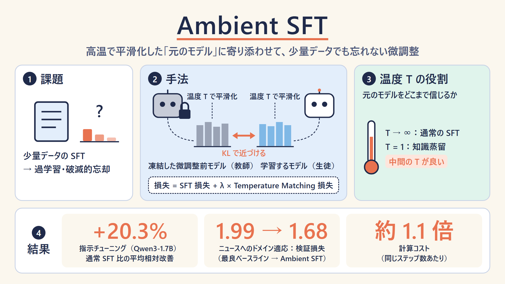

# 少ないデータで微調整しても「元のモデル」を忘れない — 高温で平滑化した自分自身に寄り添わせる Ambient SFT

## この論文のひとことまとめ

大規模言語モデル（LLM）を少量のデータで教師あり微調整（SFT: Supervised Fine-Tuning）すると、過学習や、事前学習で得た知識を失う破滅的忘却が起こりがちです。本論文は、微調整前のモデルを凍結して「ノイズの多い教師」とみなし、温度を上げて平滑化した次トークン分布どうしを一致させる正則化項（Temperature Matching）を SFT の損失に加える「Ambient SFT」を提案しました。ドメイン適応・指示チューニング・推論の 3 つの設定で、通常の SFT を上回る結果が報告されています。追加の計算コストは、実験設定で同じステップ数あたり約 1.1 倍にとどまります。

## なぜこの研究が重要か

LLM の開発は、大量のテキストで行う事前学習のあとに、指示チューニングや推論能力の付与などの事後学習（post-training）を重ねる多段の流れで進みます。事前学習は数兆トークン規模のデータを使いますが、後段では数千件程度の厳選データに頼ることが多く、段階が進むほど使えるデータが桁違いに減ります。

この差が原因で、事後学習したモデルは事前学習で身につけた幅広い知識を忘れたり、少量データに偏って現れる文体や狭い視点に引きずられたりします。こうした副作用は alignment tax とも呼ばれます。現状の主な対処は、お金と計算資源をかけて事後学習データを大量に集める「力技」です。本論文は、データを増やさずにアルゴリズムの工夫で事後学習のデータ効率を高められないか、という問いに取り組んでいます。

## 背景：何が問題だったのか

論文が想定する状況は次のとおりです。微調整前の事前学習済みモデルは手元にありますが、その事前学習データには必ずしもアクセスできません。そして、目標とする分布（たとえば特定ドメインの文章や指示応答データ）からは、小さなデータセットしか得られません。

この状況で通常の SFT を行うと、少ないデータにモデルが過剰に合わせてしまいます。事前学習データと目標データを混ぜて学習する方法（データ混合）も考えられますが、事前学習データ自体が手に入らない場合もあります。一方、事前学習モデルそのものは「その分野についてある程度は知っている」情報源です。問題は、この不完全な情報源をどこまで信じてよいかという点にあります。

## 提案手法：何をしたのか

### 着想：温度を上げると、モデル同士は似てくる

まず用語を確認します。LLM は次に来るトークン（単語の断片）の確率分布を出力します。サンプリング温度（temperature）T は、この分布の「鋭さ」を調整するつまみです。T を 1 より大きくすると分布は平らになり、どのトークンも選ばれやすくなります。

著者らは次のような思考実験から出発します。高品質な事後学習済みモデル（oracle）があるものの、その出力を高温でノイズが多い形でしか観測できないとします。著者らは、サンプル数が十分あれば、こうした高温データから学習しても、本来の温度の分布から学習した場合に匹敵しうることを示しました。

実際には高温の oracle はありません。しかし温度を上げると、どんな 2 つのモデルの出力分布も互いに近づいていきます。したがって十分に高温であれば、手元にある微調整前のモデルを oracle の代わりとして使える、というのが中心となる発想です。

### 目的関数：2 つの損失を足す

Ambient SFT では、学習するモデル（生徒、student）を事前学習済みモデルで初期化し、同じ事前学習済みモデルのコピーを教師として凍結（frozen）します。そのうえで、同じトークン位置に 2 種類の損失を課します。

- **通常の SFT 損失（Clean Cross-entropy）**: データ中の実際の次トークンを当てるための、ふつうの交差エントロピー損失です。
- **Temperature Matching 損失**: 温度 T で平滑化した教師の分布と、同じく温度 T で平滑化した生徒の分布の隔たりを KL ダイバージェンス（2 つの確率分布の違いを測る量）で測り、小さくします。

全体の損失は「SFT 損失 + λ × Temperature Matching 損失」で、λ は 2 つの項の重みです。名前の由来は、破損したデータから拡散モデルを学習する Ambient Diffusion 系の研究です。本手法では、事前学習モデルの不完全な予測を一種の「破損」とみなし、高い温度でのみ信頼するという位置づけになっています。

### 温度が「どこまで元のモデルを信じるか」を決める

温度 T は、事前学習モデルをどの程度信頼するかを調整する役割を持ちます。両極端を考えると分かりやすくなります。

- **T → ∞ の場合**: 2 つの分布はどちらも平らになって KL がほぼ 0 になり、第 2 項が消えます。つまり通常の SFT に戻ります。
- **T = 1 の場合**: 古典的な知識蒸留（Knowledge Distillation, KD）の損失と同じ形になります。

ただし通常の知識蒸留は「強い教師が弱い生徒を教える」構図です。本手法は逆で、教師は微調整前のモデルであり、生徒は最終的に教師を上回ることが期待されています。著者らは、T = 1 で教師に厳密に合わせると、未調整のモデルの弱点まで生徒に押しつけて性能を下げると述べています。

### 実装と計算コスト

実装は確率的に行います。各ステップで、確率 p_c で通常の SFT 損失だけを使い、残りの確率 1 − p_c で凍結教師の順伝播を行って Temperature Matching 損失を下げます。期待値としては λ = (1 − p_c)/p_c に相当します。

実験では通常 p_c = 0.75 とし、生徒と教師に同じモデルを使っています。この設定で、同じステップ数に対して通常の微調整より約 1.1 倍遅くなります。そのため著者らは、計算資源よりもデータが制約となる場面に向いた手法だとしています。

### 関連手法との違い

- **Hinton らの蒸留（2015）**: 異なる温度でのマッチングは以前から試されていますが、本手法の主な違いは「事前学習モデル自身が、事後学習中の自分を監督する」点です。
- **Learning without Forgetting（LwF）**: 継続学習の手法で、新タスク用に別の出力ヘッドを持ち、温度は固定です。本手法は出力空間を共有し、温度を後述のバイアス・バリアンスの調整に使います。
- **強化学習（RL）でのアライメントにおける参照モデルへの KL ペナルティ**: 本手法は RL ではなく SFT 段階を対象とし、参照モデルの高温の分布にだけ合わせる点が異なります。

### 理論面の裏づけ

論文はいくつかの理論結果を示しています。

- **高温データからでも元の分布は復元できる**: 有限の温度 T でサンプルした次トークンから学習しても、教師の分布をどの温度でも再現できる（識別可能である）ことを示しました。著者らは、高温のサンプルは意味不明な文字列に見えるのに学習信号を持つという点を、直観に反するかもしれないと述べています。
- **温度を上げると差が縮む速さ**: 事後学習モデルと事前学習モデルの、温度 T で平滑化した分布の KL は、文脈ごとに T の 2 乗に反比例する速さで小さくなる、という上界が示されています。
- **最適な温度は両極端の間にある**: 単純化したモデル（固定特徴の対数線形モデル）のもとで、推定誤差を「教師の誤りに由来するバイアス」と「データ数に反比例するバリアンス（ばらつき）」の和として表しました。そのうえで、適切な λ と T（T ≠ 1）を選べば、通常の SFT・凍結教師そのもの・知識蒸留の 3 つをいずれも上回りうることを示しています（軽い条件のもとでの結果です）。

## 結果：何が分かったのか

### 高温データだけからの学習

まず、モデルから高温でサンプルしたデータで別のモデルを学習させる実験を行いました。GPT-2 アーキテクチャと tiny Shakespeare データセットでは、提案した目的関数が、学習時の破損（温度）が強くても比較的低い検証パープレキシティ（予測の当たりにくさの指標で、低いほど良い）を保ちました。さらに、OpenWebText で学習した GPT-2 124M から高温の合成データを生成し、その意味不明に見えるテキストだけで学習したモデルが、まともな英文を生成できたと報告しています。

### ドメイン適応

OpenWebText で事前学習した 15 億パラメータ（1.5B）のモデルを、Python コード、CS 論文、生物医学テキスト、ニュース、商品レビューの 5 ドメインに適応させました。比較対象はスクラッチ学習、通常の微調整、データ混合による微調整です。検証損失（低いほど良い）は次のとおりです。

| 手法 | Python コード | CS 論文 | 生物医学 | ニュース | レビュー |
|---|---|---|---|---|---|
| 対象ドメインのみでスクラッチ学習 | 1.50 | 3.04 | 2.66 | 2.63 | 3.37 |
| 事前学習モデル（微調整なし） | 1.46 | 2.87 | 2.61 | 2.59 | 3.56 |
| 通常の微調整 | 0.80 | 2.56 | 2.36 | 2.01 | 2.96 |
| データ混合による微調整 | 0.79 | 2.55 | 2.36 | 1.99 | 2.96 |
| Ambient SFT | 0.70 | 2.54 | 2.35 | 1.68 | 2.96 |

Ambient SFT は 5 ドメインすべてでベースラインと同等以上でした。とくにニュースでは、最良のベースラインに比べてパープレキシティが 26.7% 改善しています（検証損失 1.99 → 1.68）。

効果の大きさはドメインによって異なり、Python コードとニュースで大きく、ほかでは小さめでした。微調整前のモデルがそのドメインをどれだけ得意か（ゼロショット損失）と、ベースラインに対する勝ち幅の間には、5 ドメインでスピアマン順位相関 ρ = −0.90 という強い関係が見られました。つまり、事前学習モデルがもともと得意なドメインほど、教師として役に立つということです。

そのほかの分析結果は次のとおりです。

- **温度の効果**: Python コードでは、検証損失は T = 1 から下がって T = 2.5 で最小となり、その後は上昇して頭打ちになりました。両極端のどちらも最適ではありません。
- **生徒と教師のサイズ**: 124M の小さな教師でも、より大きい 1.5B の生徒を改善でき、Python コードとニュースでは教師なしの通常微調整を上回りました。
- **データ量**: 124M モデルで Python コードの学習データを 1/3、1/10 に減らすと、Ambient SFT はデータ混合を一貫して上回り、データが少ないほど差が広がりました。著者らはこれを、理論上のバイアスはデータ数に依存せず、バリアンスは依存するという結果と整合すると述べています。

### 指示チューニング

1.7B〜14B の Qwen3 ベースモデルを、指示データ Dolci-Instruct-SFT の約 20K 文書（全体の 1%）で微調整しました。全実行で p_c = 0.75、T = 2.5 を使っています。評価には、指示追従（IFEval）、知識（MMLU、PopQA、TriviaQA）、数学（GSM8K、MATH）、コード（HumanEval+）、一般推論（BBH）のベンチマークを用いました。

通常の SFT は指示追従を大きく改善します（例: 4B で IFEval 45.5% → 76.3%）。しかし他のベンチマークでは破滅的忘却が起き、どのモデルサイズでも、SFT 前のベースモデルが通常の SFT に 6〜7 タスクで勝っていました。

Ambient SFT の、通常 SFT に対する平均相対改善は次のとおりです。

| モデル（Qwen3） | 1.7B | 4B | 8B | 14B |
|---|---|---|---|---|
| 平均相対改善 | +20.3% | +8.0% | +10.2% | +8.7% |

Ambient SFT は 8 タスク中 7 タスクで通常の SFT を改善しました。例外は IFEval で、モデルが大きくなるほど差は縮まり、14B では同じ値（78.6）でした。Qwen3-1.7B の例では、MATH が 24.3 → 40.4、GSM8K が 61.0 → 72.3、HumanEval+ が 68.0 → 83.7 と伸びた一方、IFEval は 58.8 → 52.3 に下がっています。

主な追加結果は次のとおりです。

- **小さいモデルで大きいモデルに並ぶ**: 8 ベンチマークの平均で、Ambient SFT の 8B が通常 SFT の 14B と同等でした。MATH では、Ambient SFT の 1.7B（40.4）が通常 SFT の 8B（38.7）をすでに上回っています。
- **データの出どころごとに温度を変える**: Dolci-Instruct-SFT は 21 のソースの混合で、ソースによってベースモデルの当てはまりが異なります。ソースごとに温度を設定すると、全サイズで IFEval が改善し、他の利得も保たれました（平均相対改善は 1.7B で +21.1%、4B で +8.2%、8B で +10.1%）。
- **他のモデルファミリー**: OLMo-3-7B で +15.4%、Llama-3.1-8B で +8.3% の平均相対改善でした。ただしどちらも IFEval は通常の SFT より低くなっています。
- **データ量を増やした場合**: OLMo-3-7B から始めた実験で、データ 1% で平均相対改善 15.4%、10% で 3.4%、全量（100%）でも 8.6% でした。
- **過学習への強さ**: 10% のデータで 2〜10 エポック学習させると、通常の SFT は 2 → 6 エポックで IFEval が 71.0 → 80.8 に上がる一方、MATH（37.3 → 30.0）や GSM8K（76.4 → 69.6）など他のベンチマークがすべて下がりました。Ambient SFT は同じ範囲で IFEval が 63.8 → 73.4 に上がり、他のベンチマークは 2 エポック時点から約 2 ポイント以内にとどまりました。

他の正則化手法との比較（Qwen3-1.7B、各手法の最良設定）では、平均相対改善が次のようになりました。

| 手法 | 平均相対改善（通常 SFT 比） |
|---|---|
| NEFTune | +0.8% |
| L2-SP | +15.3% |
| ラベル平滑化（Label smoothing） | −0.3% |
| 知識蒸留（T = 1） | +17.0% |
| Ambient SFT | +20.3% |

2 位は知識蒸留、つまり T = 1 に固定した Ambient SFT でした。温度を 1 より大きくすることに意味がある、という結果になっています。

### 推論

OLMo-3-7B を推論データ Dolci-Think-SFT の約 22K 例（1%）で学習し、GSM8K、AIME 2024 / 2025、HumanEval+、IFEval、GPQA で評価しました。通常 SFT に対する平均相対改善は、ベースモデルが −35.6%、知識蒸留が −7.3%、L2-SP が −37.1%、Ambient SFT が +3.5% でした。

Ambient SFT は 6 つのベンチマーク中 5 つで通常の SFT を上回りました（例: AIME24 39.8 → 44.5、GPQA 39.3 → 40.0）。GSM8K のみ 1.2 ポイント下回っています（94.2 vs 93.0）。比較した正則化手法のなかで、推論で SFT を改善したのは Ambient SFT だけでした。ただし著者ら自身、推論での改善幅はドメイン適応や指示チューニングより小さいと明記しています。

## 意義と限界

Ambient SFT は、通常の交差エントロピー損失に「微調整前の自分の予測を高温にしたものへ近づく項」を足すだけの、SFT の置き換えとして使える手法です。事前学習データがなくても、事前学習モデルそのものを情報源として活用できる点に特徴があります。著者らは、微調整データが少ないほど利得が大きいとまとめています。今後の課題としては、この考え方を SFT だけでなく、事後学習で使われる強化学習アルゴリズムへ広げることが挙げられています。

論文や結果から読み取れる限界は次のとおりです。

- **計算コストの増加**: 凍結教師の順伝播が追加で必要で、実験設定で約 1.1 倍遅くなります。計算よりデータが制約となる場面向きです。
- **事前学習モデルの得意不得意に依存**: 教師がそのドメインをあまり知らない場合、効果は小さくなります（商品レビューでは勝ち幅がほぼありませんでした）。著者らは、対象ドメインのデータが十分にあれば効果は期待できないとも述べています。ただし指示チューニングでは、全量データでも平均 8.6% の改善が報告されています。
- **指示追従での弱さ**: 指示チューニングでは IFEval だけ通常の SFT を下回りました（ソースごとの温度設定で改善）。
- **推論での改善幅は小さめ**: 他の設定に比べて利得が限られます。
- **理論の前提**: 理論解析は、固定特徴の対数線形モデルなどの単純化した仮定のもとでの結果です。

## まとめ

Ambient SFT は、微調整前のモデルを凍結した教師とし、高温で平滑化した分布どうしを近づける項を SFT に加えることで、少量データでの過学習や忘却を抑える手法です。温度は「元のモデルをどこまで信じるか」を調整するつまみとして働き、T = 1 でも無限大でもない中間の値が良いことが理論と実験の両面から示されました。ドメイン適応・指示チューニング・推論で通常の SFT を上回る一方、効果は事前学習モデルのドメイン知識に左右されます。

## 用語集

- **教師あり微調整（SFT: Supervised Fine-Tuning）**: 事前学習済みモデルを、目標とするデータで次トークン予測の損失を下げるように追加学習させる手法です。
- **事後学習（post-training）**: 事前学習のあとに行う、指示チューニング・アライメント・推論能力の付与などの段階です。
- **破滅的忘却（catastrophic forgetting）**: 新しいデータで学習した結果、以前に身につけた知識や能力を失ってしまう現象です。
- **サンプリング温度（temperature）**: モデルの出力ロジット（softmax 前のスコア）を T で割ってから確率に変換する操作です。T > 1 で分布が平らになります。
- **KL ダイバージェンス（KL divergence）**: 2 つの確率分布がどれだけ違うかを測る量で、同じなら 0 になります。
- **知識蒸留（Knowledge Distillation, KD）**: 教師モデルの出力分布に生徒モデルを近づけるよう学習させる手法です。
- **パープレキシティ（perplexity）**: 言語モデルが次のトークンをどれだけ予測しにくいかを表す指標で、低いほど良い予測です。
- **バイアス・バリアンスのトレードオフ**: 推定の誤差を「系統的なずれ（バイアス）」と「データによるばらつき（バリアンス）」に分けたとき、一方を減らすと他方が増えやすい関係のことです。

## 原論文

- Ambient LLMs: Data-Efficient Supervised Fine-tuning via Temperature Matching（https://arxiv.org/abs/2611.23229）
